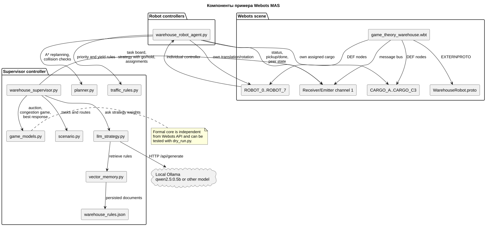
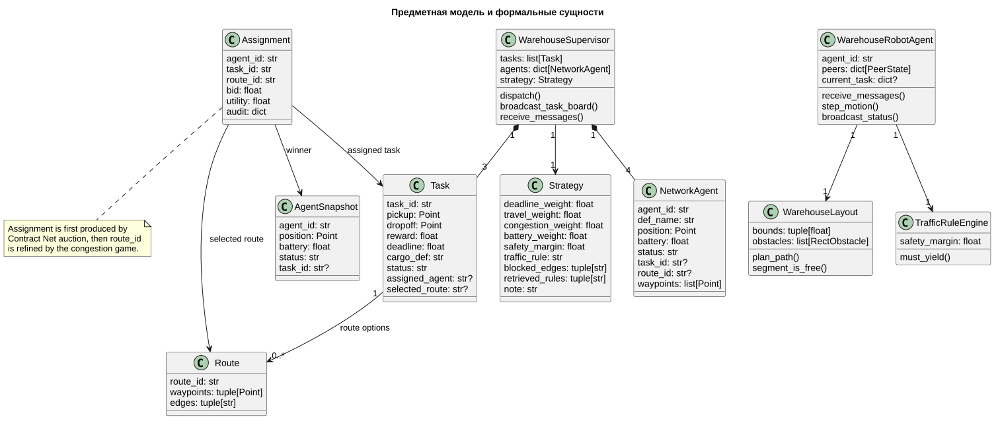
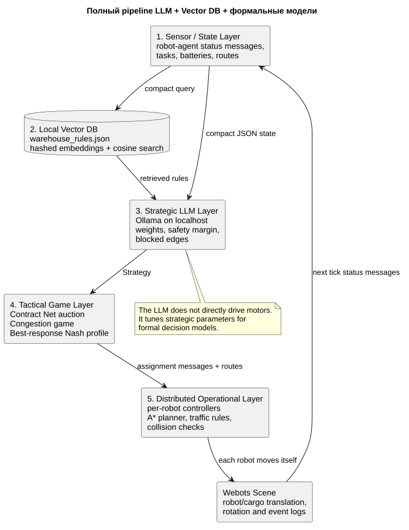
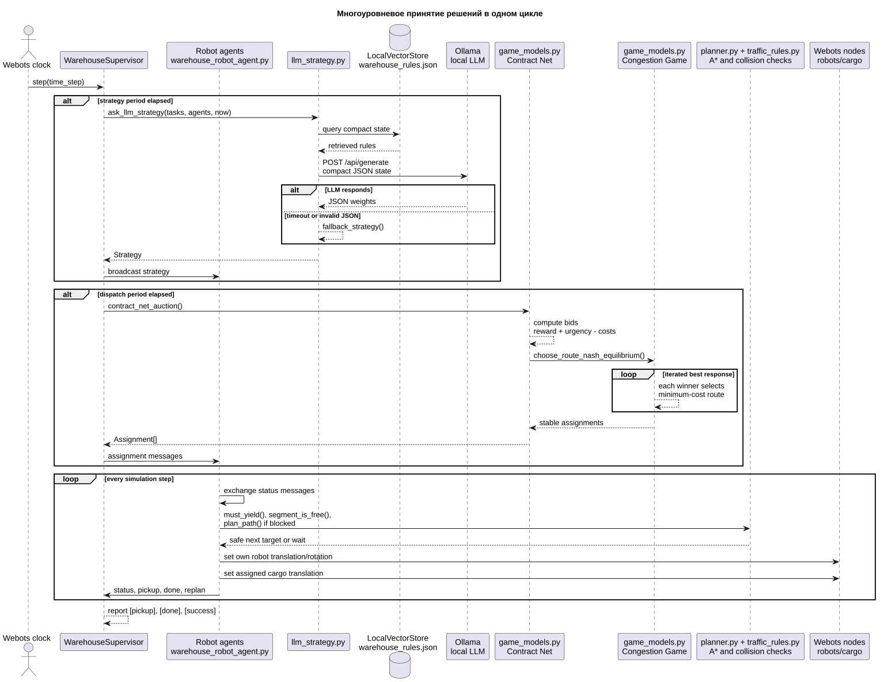
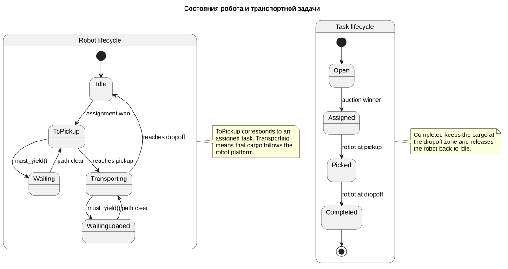

# Как работает сцена Webots: складская доставка с многоуровневым принятием решений

Этот документ поясняет, что происходит в сцене `game_theory_warehouse.wbt`, какие формальные модели используются в контроллере и как локальная LLM через Ollama встраивается в общий контур принятия решений.

Основной сценарий: восемь мобильных складских роботов работают в одном складе и совместно закрывают девять транспортных заявок. Заявки соответствуют конфигурации `large_maintenance_9_tasks_8_robots`: все грузы A/B/C, A2/B2/C2 и A3/B3/C3 открыты сразу, есть дополнительные обходные маршруты и стратегический профиль, где центральные ребра считаются загруженными инспекцией, но не закрываются полностью. Supervisor координирует сеть роботов: публикует task board, стратегию и назначения. Каждый робот имеет собственный контроллер, получает сообщения через `Emitter/Receiver`, сам исполняет маршрут и обменивается статусами с другими роботами.

## Где находятся файлы

```text
webots_game_theory_warehouse/
  worlds/
    game_theory_warehouse.wbt
  protos/
    WarehouseRobot.proto
  controllers/
    warehouse_robot_agent/
      warehouse_robot_agent.py
    warehouse_supervisor/
      warehouse_supervisor.py
      game_models.py
      llm_strategy.py
      scenario.py
      dry_run.py
    passive_robot/
      passive_robot.py
  docs/
    SCENE_AND_ARCHITECTURE.md
    diagrams/
      components.puml
      domain_model.puml
      decision_sequence.puml
      state_machine.puml
```

## Что видно на сцене

Мир использует стандартную для Webots систему координат `ENU`: склад лежит в горизонтальной плоскости `X-Y`, вертикальная ось направлена по `Z`. Поэтому режим `Top View` действительно показывает склад сверху.

На сцене есть несколько смысловых зон. Ниже используются не экранные "лево/право", а координаты склада в системе `ENU`: восток — `+X`, север — `+Y`, высота — `+Z`.

Текущий мир увеличен по горизонтали в `3.4` раза относительно первого компактного прототипа. Поэтому площадь склада стала в `11.56` раза больше. Базовые компактные координаты масштабируются в `controllers/warehouse_supervisor/warehouse_geometry.py`, а `scenario.py` уже отдает Webots и контроллерам увеличенные координаты.

- `CARGO_A`: стартует в юго-западной зоне (`X < 0`, `Y < 0`) и едет в северо-восточный док (`X > 0`, `Y > 0`).
- `CARGO_B`: стартует в северо-западной зоне (`X < 0`, `Y > 0`) и едет в юго-восточный док (`X > 0`, `Y < 0`).
- `CARGO_C`: стартует у южного входа центрального коридора (`Y < 0`) и едет к северному доку (`Y > 0`).
- Центральный перекресток: короткий маршрут, но он общий для нескольких роботов и поэтому может создавать конфликт.
- Северный, южный, восточный и западный обходы: более длинные маршруты, которые помогают разгрузить центр.
- Стеллажи и доки: визуальная структура склада, чтобы студент видел не абстрактные точки, а транспортную задачу в складской среде.
- Восемь роботов `ROBOT_0 ... ROBOT_7`: локальный `PROTO WarehouseRobot` с корпусом, колесами, платформой под груз и сенсорной стойкой.

Роботы управляются индивидуальными Python-контроллерами `warehouse_robot_agent.py`. У каждого робота есть `Receiver` и `Emitter` с общим сетевым каналом. Робот получает назначение, локально планирует путь, уступает по правилам движения, переносит свой груз и публикует сообщения `status`, `pickup`, `done`, `replan`. Supervisor не двигает роботов напрямую.

## Компоненты



Исходник диаграммы: [components.puml](diagrams/components.puml).

Ключевая идея архитектуры: Webots отвечает за сцену и узлы, supervisor координирует сеть и task board, индивидуальные robot-agent контроллеры исполняют движение, `game_models.py` не зависит от Webots и содержит чистую формальную логику, а `llm_strategy.py` подключает локальную Ollama как стратегический советчик.

## Данные сценария

Заявки определены в `controllers/warehouse_supervisor/scenario.py`:

Все девять заявок открыты сразу. Вместо искусственных волн используется диспетчерский шлюз в `Strategy`: LLM/RAG и guardrail выбирают `go_agents`, `hold_agents`, `max_active_tasks` и `max_new_assignments`, чтобы часть роботов ждала освобождения коридоров, pickup-зон и dropoff-зон. Для основной сцены `max_active_tasks=3`, потому что одновременно есть три независимых семейства зон A/B/C; повторные задачи A2/A3, B2/B3, C2/C3 ждут освобождения своей зоны.

| Задача | Забор | Доставка | Награда | Дедлайн | Груз |
|---|---:|---:|---:|---:|---|
| `A` | `(-18.224, -8.160)` | `(18.224, 8.432)` | `12.0` | `272.0` | `CARGO_A` |
| `B` | `(-18.224, 8.160)` | `(18.224, -8.432)` | `10.0` | `323.0` | `CARGO_B` |
| `C` | `(0.000, -14.416)` | `(0.000, 14.416)` | `14.0` | `340.0` | `CARGO_C` |
| `A2` | `(-18.224, -9.210)` | `(18.224, 8.432)` | `11.65` | `333.2` | `CARGO_A2` |
| `B2` | `(-18.224, 9.210)` | `(18.224, -8.432)` | `9.65` | `384.2` | `CARGO_B2` |
| `C2` | `(-1.050, -14.416)` | `(0.000, 14.416)` | `13.65` | `401.2` | `CARGO_C2` |
| `A3` | `(-18.224, -7.110)` | `(18.224, 8.432)` | `11.3` | `394.4` | `CARGO_A3` |
| `B3` | `(-18.224, 7.110)` | `(18.224, -8.432)` | `9.3` | `445.4` | `CARGO_B3` |
| `C3` | `(1.050, -14.416)` | `(0.000, 14.416)` | `13.3` | `462.4` | `CARGO_C3` |

Для каждой задачи задано несколько маршрутов. Например, задача `A` может идти через центр (`A_center`) или по южному обходу (`A_south_bypass`). Маршрут хранит:

- `route_id`: идентификатор маршрута;
- `waypoints`: последовательность точек движения;
- `edges`: смысловые ребра графа склада, например `west_center`, `south_center`, `north_bypass`.

Именно `edges` нужны для игры с заторами: если несколько маршрутов используют одно и то же ребро, стоимость этих маршрутов растет.

## Предметная модель



Исходник диаграммы: [domain_model.puml](diagrams/domain_model.puml).

Важные сущности:

- `Task`: транспортная заявка с координатами, наградой, дедлайном и статусом.
- `Route`: кандидатный маршрут для конкретной задачи.
- `AgentSnapshot`: компактное состояние робота для принятия решений.
- `Strategy`: стратегические веса, полученные от локальной LLM или fallback-логики.
- `Assignment`: результат назначения задачи роботу и выбора маршрута.
- `NetworkAgent`: состояние робота, известное координатору по сетевым `status` сообщениям.
- `WarehouseRobotAgent`: локальный контроллер робота, исполняющий маршрут и collision avoidance.
- `WarehouseSupervisor`: координатор сети роботов, а не центральный исполнитель движения.

## Многоуровневое принятие решений

Система специально разделена на три уровня.

### 1. Стратегический уровень: локальная LLM

Файл: `controllers/warehouse_supervisor/llm_strategy.py`.

Supervisor периодически извлекает релевантные правила из локальной векторной базы `warehouse_rules.json`, затем передает в Ollama компактное состояние склада:

- текущее время;
- статусы задач;
- сколько осталось до дедлайна;
- статусы роботов;
- список известных ребер центрального графа.
- `dispatch_context`: число открытых заявок, число свободных роботов и явная потребность выбрать `go_agents`/`hold_agents`.
- найденные правила движения и безопасности из векторной базы.

LLM должна вернуть JSON:

```json
{
  "deadline_weight": 1.2,
  "travel_weight": 1.0,
  "congestion_weight": 1.6,
  "battery_weight": 0.7,
  "safety_margin": 0.62,
  "traffic_rule": "deadline_priority_right_hand",
  "blocked_edges": [],
  "go_agents": ["R4", "R5", "R6"],
  "hold_agents": ["R0", "R1", "R2", "R3", "R7"],
  "max_active_tasks": 3,
  "max_new_assignments": 3,
  "note": "prefer balanced routing"
}
```

Эти поля не задают скорость колес и не строят траектории. LLM меняет параметры целевой функции, политики безопасности и шлюз допуска к аукциону. `go_agents` означает "можно участвовать в следующем Contract Net", `hold_agents` означает "оставаться свободным и ждать". Это важный методический момент: языковая модель не заменяет формальную модель, а настраивает ее стратегические приоритеты.

По умолчанию supervisor не дожидается Ollama внутри Webots-loop. При старте он сразу публикует `fallback_strategy`, затем запускает RAG+LLM-запрос в фоновом worker-потоке и продолжает аукционы, маршрутизацию и обмен сообщениями на последней валидной стратегии. Когда ответ готов, новая стратегия применяется в основном Webots-потоке и рассылается роботам. `fallback_strategy` используется, если Ollama недоступна, вернула невалидный JSON или если числовой timeout фонового запроса истек.

### 2. Тактический уровень: аукцион задач

Файл: `controllers/warehouse_supervisor/game_models.py`, функция `contract_net_auction`.

Модель соответствует идее `Contract Net Protocol`:

1. Свободные роботы рассматривают открытые задачи.
2. Для каждой пары робот-задача считается ставка.
3. Побеждают лучшие ставки без повторного использования одного робота или одной задачи.

Ставка:

```text
bid = reward + urgency - pickup_cost - battery_penalty
```

Где:

- `reward` задается в сценарии;
- `urgency` растет, когда дедлайн приближается;
- `pickup_cost` зависит от расстояния до точки забора;
- `battery_penalty` штрафует робота с низкой батареей.

Таким образом, робот не получает ближайший груз автоматически. Он получает задачу, для которой его полезность выше с учетом награды, срочности и собственного состояния.

### 3. Тактический уровень: игра с заторами и равновесие Нэша

После аукциона нужно выбрать маршруты. Если все победители пойдут через центр, центр станет конфликтной зоной. Поэтому маршруты выбираются как конечная игра с заторами (`congestion game`).

Стоимость маршрута:

```text
cost = route_length * travel_weight
     + congestion * congestion_weight
     + blocked_edge_penalty
```

Где:

- `route_length` — геометрическая длина пути;
- `congestion` — сколько раз ребра маршрута используются другими назначениями;
- `congestion_weight` — стратегический вес от LLM или fallback;
- `blocked_edge_penalty` — большой штраф за ребро, которое стратегия считает закрытым.

Функция `choose_route_nash_equilibrium` запускает `iterated best response`:

1. Берем текущие маршруты.
2. Для каждого назначенного робота считаем лучший ответ при фиксированных маршрутах остальных.
3. Если робот может снизить свою стоимость, он меняет маршрут.
4. Повторяем, пока никто не хочет менять маршрут.

В этой малой конечной игре получаем устойчивый профиль маршрутов: ни одному роботу не выгодно единолично перейти на другой маршрут. Это интерпретируется как чистое равновесие Нэша для выбранного набора задач.

### 4. Операционный уровень: движение и локальные конфликты

Файл: `controllers/warehouse_robot_agent/warehouse_robot_agent.py`.

Каждый робот исполняет назначение сам:

1. Робот получает `waypoints`.
2. Движется к точке забора.
3. При достижении `pickup` робот отправляет событие `pickup`, а груз визуально переносится на его платформу.
4. Робот продолжает движение к `dropoff`.
5. При достижении точки доставки задача становится `completed`, груз остается в зоне доставки.

Дополнительно есть локальное правило уступания `must_yield`: если следующий короткий шаг приводит к опасному сближению, робот с менее срочным дедлайном уступает. Это не заменяет игру маршрутов, а работает как реактивный уровень безопасности.

Файл `controllers/warehouse_supervisor/planner.py` используется каждым `warehouse_robot_agent` и добавляет полноценный слой объезда:

- статическая карта склада задается как occupancy grid;
- стеллажи и стены представлены прямоугольными препятствиями;
- робот проверяется как safety disk с радиусом безопасности;
- если выбранный сегмент пересекает препятствие или другого робота, строится локальный объезд A*;
- если безопасного короткого шага нет, робот ожидает и повторяет планирование.

Файл `controllers/warehouse_supervisor/traffic_rules.py` задает правила движения:

- сначала приоритет у более срочного дедлайна;
- при равном классе срочности загруженный робот имеет приоритет перед пустым;
- при равенстве применяется правило правой стороны;
- если все равно ничья, выигрывает стабильный порядок по `agent_id`.

## Полный LLM Pipeline



Исходник диаграммы: [llm_pipeline.puml](diagrams/llm_pipeline.puml).

Полный pipeline теперь выглядит так:

1. Sensor/state layer: роботы публикуют `status`; supervisor собирает task board, позиции роботов, батарею и занятость маршрутов.
2. Vector memory/RAG: `LocalVectorStore` извлекает правила склада, релевантные текущему состоянию.
3. Strategic LLM layer: Ollama возвращает веса и ограничения.
4. Tactical game layer: Contract Net назначает задачи, congestion game выбирает маршруты.
5. Operational control layer: каждый робот локально применяет A* planner, traffic rules и collision checks, затем сам обновляет положение своей платформы в Webots.

## Наблюдаемость LLM и Vector DB

Стратегический уровень теперь явно логирует RAG и LLM pipeline:

- `[vector-db]`: путь к `warehouse_rules.json`, число документов, размерность хеш-эмбеддинга и список id.
- `[vector-query]`: компактный запрос, который был построен из текущего состояния склада, и top-k найденных правил со score.
- `[llm-request]`: модель Ollama, URL, timeout, число задач/агентов и список retrieved rules.
- `[llm-response]`: итоговая стратегия после парсинга и нормализации чисел.
- `[llm-fallback]`: причина перехода на deterministic fallback, если Ollama недоступна или вернула невалидный JSON.

Для отладки полного prompt и сырого ответа модели используется:

```bash
export MAS_LLM_DEBUG=1
```

Поиск по vector DB можно отключить из логов, не отключая сам RAG:

```bash
export MAS_VECTOR_DEBUG=0
```

Для ручного просмотра базы:

```bash
python3 controllers/warehouse_supervisor/inspect_vector_db.py
python3 controllers/warehouse_supervisor/inspect_vector_db.py --query "dynamic collision avoidance at crossing" --top-k 3
```

## Последовательность одного цикла



Исходник диаграммы: [decision_sequence.puml](diagrams/decision_sequence.puml).

Типичный лог при запуске:

```text
[strategy] {"blocked_edges": [], "congestion_weight": 3.8, "go_agents": ["R4", "R5", "R6"], ...}
[dispatch-gate] active=0/3 max_new=3 go=['R4', 'R5', 'R6'] hold=['R0', 'R1', 'R2', 'R3', 'R7'] ...
[auction] agent=R6 task=C route=C_center ...
[auction] agent=R4 task=A route=A_south_bypass ...
[auction] agent=R5 task=B route=B_center ...
[pickup] agent=R6 task=C
[pickup] agent=R4 task=A
[pickup] agent=R5 task=B
[done] agent=R5 task=B route=B_center completed_at=120.6 deadline=323.0
[done] agent=R2 task=A2 route=A_center_2 completed_at=271.4 deadline=333.2
[success] completed=A,B,C,A2,B2,C2,A3,B3,C3 time=391.9
```

Здесь видно, что центральные линии не запрещены: часть задач идет через `B_center`, `C_center`, `A_center_2`, а часть уходит в обходы. Ожидание свободных роботов связано с `max_active_tasks=3` и занятостью семейств зон `A/B/C`, а не с искусственными волнами.

## Состояния робота и задачи



Исходник диаграммы: [state_machine.puml](diagrams/state_machine.puml).

Состояния робота:

- `idle`: свободен, участвует в аукционе;
- `to_pickup`: назначен на задачу и едет к грузу;
- `transporting`: груз забран, робот едет к точке доставки;
- локально может ожидать, если должен уступить другому роботу.

Состояния задачи:

- `open`: еще не назначена;
- `assigned`: победитель аукциона выбран;
- `picked`: груз находится на роботе;
- `completed`: груз доставлен.

## Как Webots-сцена связана с Python

В `worlds/game_theory_warehouse.wbt` у важных объектов есть `DEF`-имена:

- `ROBOT_0 ... ROBOT_7`;
- `CARGO_A`, `CARGO_B`, `CARGO_C` и дополнительные одновременные грузы `CARGO_A2` ... `CARGO_C3`.

Supervisor получает узлы через `getFromDef`, затем меняет поля:

- `translation` робота: `[x, y, ROBOT_Z]`;
- `rotation` робота: поворот вокруг оси `Z`;
- `translation` груза: либо начальная/конечная точка, либо позиция платформы робота.

Поэтому в Webots нет отдельной физики захвата груза. Для учебного примера груз переносится локальным контроллером назначенного робота, чтобы внимание оставалось на многоагентном принятии решений, а не на манипуляторной кинематике.

## Как проверить пример

Быстрая проверка формальной модели без Webots:

```bash
python3 controllers/warehouse_supervisor/dry_run.py
```

Проверка в Webots batch-режиме:

```bash
WEBOTS_AUTO_QUIT=1 WEBOTS_HOME=/Applications/Webots.app/Contents \
/Applications/Webots.app/Contents/MacOS/webots \
  --batch --mode=fast --stdout --stderr \
  worlds/game_theory_warehouse.wbt
```

Ожидаемый финал:

```text
[success] completed=A,B,C
```

## Как перегенерировать UML-диаграммы

В папке проекта уже лежит `plantuml.jar`. Из корня `webots_game_theory_warehouse`:

```bash
java -Djava.awt.headless=true -jar plantuml.jar -tsvg docs/diagrams/*.puml
```

После этого SVG-файлы в `docs/diagrams` обновятся, а этот Markdown начнет показывать новые версии диаграмм. На macOS режим `headless` помогает избежать зависаний Java-рендера на системных шрифтах.
