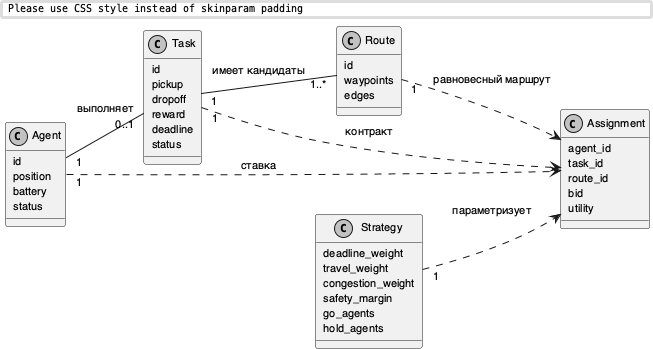
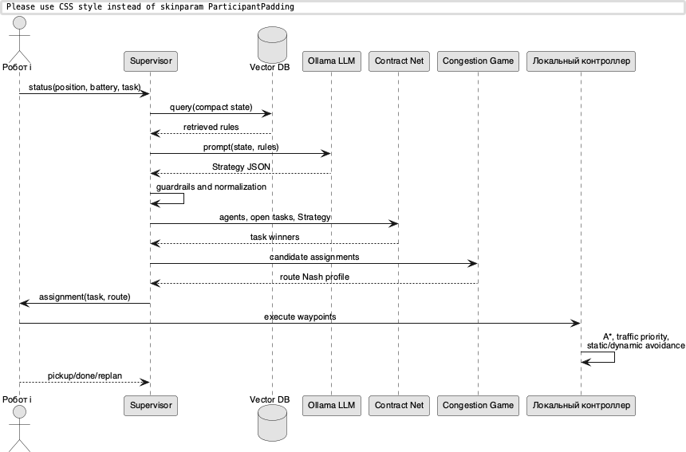
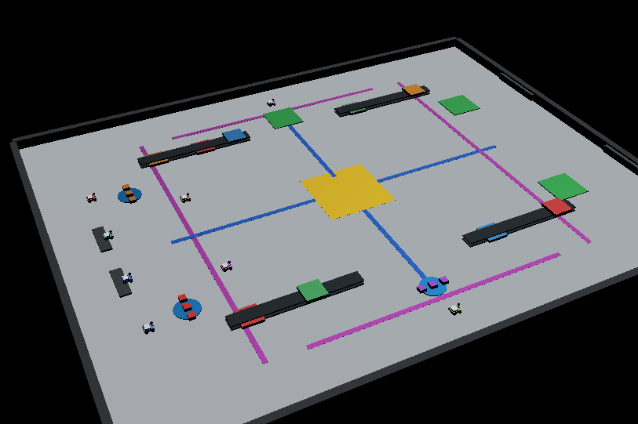
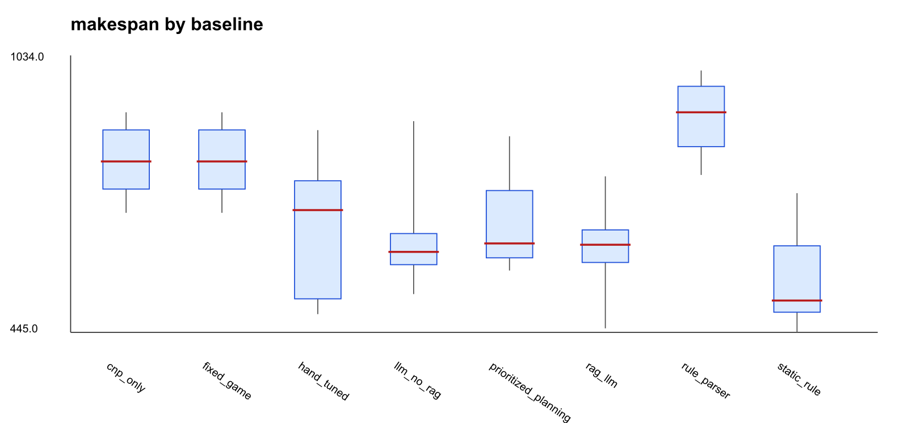
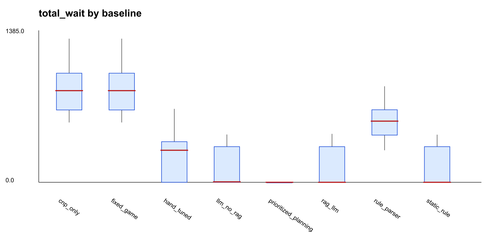

# Ограниченная RAG-LLM-параметризация формальных моделей координации в складской многоагентной робототехнической системе

**Автор:** Анонимизировано для рецензирования

## Аннотация

Исследуется simulation-based warehouse-like многоагентная транспортная система, в которой несколько мобильных роботов выполняют заявки при наличии общих коридоров, альтернативных обходов и текстовых эксплуатационных правил. Проблема состоит в том, что классические модели назначения задач и выбора маршрутов требуют численных параметров, тогда как часть контекста задается естественным языком: инспекционный трафик, дозирование выпуска роботов, приоритеты и ограничения зон погрузки. Предложен подход, в котором локальная LLM не управляет роботами напрямую, а формирует ограниченный стратегический вектор для формальных моделей. RAG-компонент извлекает правила из локальной SQLite vector DB с PyTorch-векторизацией; LLM Ollama возвращает JSON-кандидат стратегии; guardrails проверяют типы, диапазоны, идентификаторы роботов и ребер. Далее Contract Net Protocol назначает заявки, конечная игра с заторами выбирает маршруты, а индивидуальные Webots-контроллеры выполняют локальное движение. Новизна заключается в трактовке LLM как bounded strategic parameterizer, совместимого с нейросимвольной и когнитивно-автоматизационной парадигмами, но отделенного от физического контура управления. В серии из 30 случайных вариантов LM-9 живой RAG-LLM снизил средний makespan относительно Contract Net без игры с заторами с 829.9±75.4 до 645.5±83.1 с, однако LLM без RAG в этом сценарии была практически неотличима: 645.7±83.3 с. Специализированное static-rule правило осталось сильнее: 559.1±103.8 с. Чтобы отделить вклад retrieval от прямой подсказки в prompt, проведена дополнительная policy-masked серия: prompt содержит только коды SOP-C7/DOCK-AMBER без расшифровки правила, а поток увеличен до 15-18 грузов. В ней deterministic RAG-LLM replay снизил makespan относительно LLM no RAG с 1882.9±254.1 до 1315.4±159.2 с, а embedding-rule baseline - до 1517.3±240.0 с; live Ollama-пилот на 10 seed дал 1439.7±398.7 против 1331.2±139.8 с. Это показывает, что embedding/RAG дает измеримый эффект, когда эксплуатационное правило не раскрыто напрямую в prompt.

**Ключевые слова:** многоагентные системы; складская робототехника; Contract Net Protocol; игры с заторами; RAG; локальные языковые модели; Webots; нейросимвольный ИИ.

# Введение

Складские робототехнические системы являются характерным примером
многоагентных систем, где производительность определяется не только
скоростью отдельных роботов, но и согласованностью решений на разных
уровнях. Роботы конкурируют за заявки, используют общие коридоры,
ожидают освобождения зон погрузки и должны локально избегать
столкновений. Поэтому единый монолитный диспетчер быстро становится либо
слишком грубым, либо трудно проверяемым.

Классические модели дают воспроизводимые решения для отдельных частей
задачи. Contract Net Protocol формализует распределение заявок, игры с
заторами описывают выбор маршрутов в общей сети, а алгоритмы поиска пути
и локального объезда обеспечивают операционное движение. Однако
эксплуатационные правила склада часто не задаются числовыми таблицами.
Они формулируются текстом: центральный коридор временно занят
инспекционной тележкой; в одну pickup/dropoff-зону нельзя выпускать
несколько роботов; при перегрузке центра следует использовать обходы;
при задержке стратегического сервиса надо продолжать движение по
последней валидной стратегии. Для формальных моделей такой текст должен
быть преобразован в веса, ограничения и допустимые множества агентов.

Объектом исследования является simulation-based warehouse-like
многоагентная транспортная система. Предмет исследования – механизм
преобразования текстовых эксплуатационных правил в параметры формальных
моделей назначения задач и маршрутизации. Исследовательский вопрос
формулируется так: можно ли включить LLM в многоагентную
робототехническую систему так, чтобы использовать ее способность
интерпретировать текстовые правила, но сохранить проверяемость,
воспроизводимость и безопасность формальных алгоритмов?

Предлагаемый ответ состоит в ограничении роли LLM. Модель не генерирует
траектории, не задает скорости колес и не изменяет локальный контроллер.
Она возвращает только стратегический вектор:
$$\Theta=(w_d,w_l,w_c,w_b,\mu,E_b,A^{go},A^{hold},N^{act},N^{new}),$$
где $w_d,w_l,w_c,w_b$ – веса дедлайна, пути, заторов и батареи, $\mu$ –
safety margin, $E_b$ – мягко заблокированные ребра, $A^{go}$ и
$A^{hold}$ – множества допуска и ожидания роботов, $N^{act}$ и $N^{new}$
– лимиты активных и новых назначений. Все значения проходят guardrails и
затем используются формальными процедурами.

Вклад работы состоит в следующем. Во-первых, предложена
логико-алгебраическая модель, разделяющая назначение задач, игру выбора
маршрутов и локальное исполнение. Во-вторых, разработан RAG-LLM-контур,
в котором локальная Ollama-модель получает правила из SQLite vector DB и
возвращает только типизированный стратегический JSON. В-третьих,
реализован Webots-проект с индивидуальными контроллерами роботов и
координатором сети, который не является ручным водителем роботов.
В-четвертых, проведен статистический эксперимент с 30 случайными
вариантами LM-9, policy-masked абляцией SOP-правил,
baseline-сравнениями, доверительными интервалами, paired sign test,
анализом retrieval-качества, задержки LLM и устойчивости к ошибкам RAG.

# Обзор литературы

Распределение задач между роботами традиционно рассматривается в рамках
Multi-Robot Task Allocation. Gerkey и Matarić (Gerkey и Matarić 2004)
предложили таксономию MRTA, связывающую типы задач, роботов и
оптимизационные критерии. Contract Net Protocol (Smith 1980) остается
одной из наиболее естественных моделей распределения транспортных
заявок: роботы формируют ставки, а координатор выбирает победителей.
Рыночные подходы к координации роботов (Dias и др. 2006; Zlot и Stentz
2006) хорошо масштабируются, но качество решения зависит от состава
функции ставки и параметров ограничений. В складских AGV/AMR-системах
эта зависимость усиливается: обзоры Le-Anh и De Koster (Le-Anh и De
Koster 2006), а также Fragapane и соавт. (Fragapane и др. 2021)
показывают, что диспетчеризация, управление трафиком и структура
маршрутов существенно влияют на throughput, waiting time и deadlock
risk.

Вторая линия работ связана с маршрутизацией в общей инфраструктуре. Игры
с заторами Rosenthal (Rosenthal 1973) описывают ресурсы, стоимость
которых растет с числом пользователей. Monderer и Shapley (Monderer и
Shapley 1996) показали связь таких моделей с потенциальными играми, а
Roughgarden и Tardos (Roughgarden и Tardos 2002) исследовали
неэффективность эгоистичной маршрутизации. Для складского графа это
означает, что центральный коридор можно рассматривать как общий ресурс с
возрастающей стоимостью. На операционном уровне используются A\* (Hart,
Nilsson, и Raphael 1968), потенциальные поля (Khatib 1986), Dynamic
Window Approach (Fox, Burgard, и Thrun 1997), общая теория планирования
движения (LaValle 2006), а также MAPF и Conflict-Based Search (Yu и
LaValle 2013; Sharon и др. 2015). Эти методы решают геометрические и
комбинаторные конфликты, но сами по себе не интерпретируют текстовые
эксплуатационные правила.

Третья линия относится к LLM и RAG. Retrieval-Augmented
Generation (Lewis и др. 2020) позволяет подключать внешние документы к
генерации ответа. Chain-of-thought (Wei и др. 2022), ReAct (Yao и др.
2023) и обзоры LLM-агентов (Xi и др. 2023) показывают переход от
статических ответов к циклам рассуждения, памяти и инструментального
взаимодействия. В робототехнике SayCan (Ahn и др. 2022), Code as
Policies (Liang и др. 2022), PaLM-E (Driess и др. 2023), Grounded
Decoding (Huang и др. 2023), SayPlan (Rana и др. 2023), Eureka (Ma и др.
2024) и VLM-ограничения для task-and-motion planning (Kumar и др. 2024)
демонстрируют, что языковые модели могут связывать инструкции,
affordances, reward/cost specification и планы. Современные обзоры LLM в
робототехнике (Wang и др. 2024; Li и др. 2025) фиксируют два ключевых
риска: прямое управление через LLM небезопасно, а надежность вывода
требует ограничений, мониторинга и fallback.

Четвертая линия связана с нейросимвольным ИИ и cognitive automation.
Нейросимвольные подходы стремятся объединить интерпретируемые
символические структуры с гибкостью нейронных моделей (Sarker и др.
2021). Cognitive automation рассматривает автоматизацию как перенос
части когнитивных операций в программный контур при обязательном анализе
пригодности use case и риска (Engel и др. 2024). Предлагаемая
архитектура развивает эти идеи: LLM интерпретирует текстовые правила, но
итоговое решение принимает символически заданный pipeline. Работы по
guardrails (Dong и др. 2024) и безопасному LLM-планированию (Obi и др.
2025) дополнительно показывают, что выход языковой модели должен быть
ограничен схемой, проверен и отделен от физического управления.

Таким образом, существующие работы дают сильные компоненты: MRTA для
назначения, congestion games и MAPF для маршрутизации, RAG/LLM для
интерпретации текста, guardrails для ограничения вывода. Недостаточно
разработан именно связующий механизм, в котором LLM переводит
эксплуатационный текст в параметры формальных моделей, а не заменяет их.
Эта лакуна и определяет позиционирование данной работы.

| Направление           | Что решает                                   | Что не закрывает                            | Роль в работе          |
|:----------------------|:---------------------------------------------|:--------------------------------------------|:-----------------------|
| MRTA/Contract Net     | Назначение заявок агентам                    | Выбор параметров ставки из текстовых правил | Тактический уровень    |
| Congestion games/MAPF | Конфликты маршрутов и общих ресурсов         | Интерпретация эксплуатационного контекста   | Маршрутизация          |
| LLM robotics          | Инструкции, планы, cost/reward specification | Риск прямого управления и галлюцинаций      | Стратегический адаптер |
| Neuro-symbolic AI     | Связь нейронной интерпретации и символики    | Не задает конкретный складской pipeline     | Методологическая рамка |
| Guardrails/safe LLM   | Ограничение вывода модели                    | Не определяет MRTA/MAPF-алгоритм            | Runtime-монитор        |

Позиционирование подхода относительно смежных направлений.

# Постановка задачи и формальная модель

Пусть склад задан ориентированным графом $G=(V,E)$, где вершины
соответствуют зонам, перекресткам и докам, а ребра – допустимым
проходам. Множество роботов обозначается $A=\{a_1,\ldots,a_m\}$,
множество заявок – $T=\{\tau_1,\ldots,\tau_n\}$, множество маршрутов для
заявки $\tau$ – $R_\tau$. Робот описывается кортежем
$a=(x_a,\beta_a,\sigma_a,\tau_a)$, где $x_a$ – положение, $\beta_a$ –
нормированный заряд, $\sigma_a$ – статус, $\tau_a$ – текущая заявка.
Заявка задается как $\tau=(p_\tau,d_\tau,\rho_\tau,\delta_\tau,s_\tau)$:
pickup, dropoff, reward, deadline и статус.

| Обозначение       | Смысл                                                         |
|:------------------|:--------------------------------------------------------------|
| $A,T,V,E$         | множества роботов, заявок, вершин и ребер складского графа    |
| $R_\tau$          | конечное множество допустимых маршрутов заявки $\tau$         |
| $y_{a\tau}$       | бинарная переменная назначения робота $a$ на заявку $\tau$    |
| $L(r)$            | геометрическая длина маршрута $r$                             |
| $n_e(\mathbf r)$  | число выбранных маршрутов, использующих ребро $e$             |
| $E_b$             | множество ребер, получивших стратегический штраф              |
| $A^{go},A^{hold}$ | роботы, которым разрешено или запрещено получать новые заявки |
| $N^{act},N^{new}$ | лимиты активных задач и новых назначений за один цикл         |
| $\Theta$          | стратегический вектор, прошедший guardrails                   |

Основные обозначения модели.

Задача разделяется на две связанные подзадачи. Первая – назначение:
$$\sum_{\tau\in T}y_{a\tau}\le1,\quad
\sum_{a\in A}y_{a\tau}\le1,\quad
y_{a\tau}\in\{0,1\}.$$ Дополнительно вводится отображение семейства
заявок $\phi:T\rightarrow\{A,B,C,\ldots\}$ и ограничение вместимости
зоны:
$$\sum_{\tau:\phi(\tau)=g}\mathbb{I}(s_\tau\notin\{\text{open},\text{completed}\})\le1.$$
Оно заменяет искусственные волны заявок: все задачи могут быть открыты с
начала, но одновременно исполняется не более одной заявки на семью
pickup/dropoff-зоны.

Ставка Contract Net имеет вид $$b(a,\tau,t)=
\rho_\tau+w_d\frac{\rho_\tau}{\max(\delta_\tau-t,\varepsilon)}
-w_l\,dist(x_a,p_\tau)-w_b(1-\beta_a).$$ Жадный Contract Net
упорядочивает допустимые пары $(a,\tau)$ по $b(a,\tau,t)$ и выбирает
победителей с учетом $A^{go}$, $A^{hold}$, $N^{act}$ и $N^{new}$.
Сложность одного цикла равна $O(mn\log(mn))$ из-за сортировки ставок.
Алгоритм не гарантирует глобального оптимума, но достаточен для
онлайн-сценария, где решения пересчитываются периодически и должны быть
объяснимыми.

Вторая подзадача – маршрутизация назначенных заявок. Для профиля
маршрутов $\mathbf r$ стоимость маршрута задается как
$$c_i(r_i,\mathbf r_{-i}) =
w_l L(r_i)+w_c\sum_{e\in r_i} n_e(\mathbf r)+
M\sum_{e\in r_i}\mathbb{I}(e\in E_b),$$ где $M$ – большой штраф. Для
конечной игры с заторами существует potential function:
$$\Phi(\mathbf r)=
\sum_i w_l L(r_i)+
w_c\sum_{e\in E}\sum_{k=1}^{n_e(\mathbf r)}k+
M\sum_i\sum_{e\in r_i}\mathbb{I}(e\in E_b).$$ Одностороннее изменение
маршрута игроком меняет $\Phi$ на ту же величину, что и индивидуальную
стоимость. Следовательно, игра является exact potential game, и динамика
лучших ответов на конечном множестве маршрутов достигает чистого
равновесия Нэша. В реализации используется не более 12 раундов best
response, что достаточно для малых маршрутных множеств Webots-сценария.

Стратегический вектор $\Theta$ входит в формальные модели строго
ограниченным образом.
Табл. <a href="#tab:strategy-map" data-reference-type="ref"
data-reference="tab:strategy-map">3</a> показывает, какие поля LLM могут
изменить и где именно они используются.

| Поле стратегии    | Формула/процедура     | Эффект                                            |
|:------------------|:----------------------|:--------------------------------------------------|
| $w_d$             | $b(a,\tau,t)$         | усиливает срочность дедлайнов                     |
| $w_l$             | $b(a,\tau,t)$ и $c_i$ | меняет цену расстояния до pickup и длины маршрута |
| $w_c$             | $c_i$ и $\Phi$        | штрафует совместное использование ребер           |
| $w_b$             | $b(a,\tau,t)$         | снижает ставки роботов с малым зарядом            |
| $E_b$             | $c_i$                 | вводит большой штраф для отдельных ребер          |
| $A^{go},A^{hold}$ | фильтр Contract Net   | дозирует выпуск роботов без волн заявок           |
| $N^{act},N^{new}$ | ограничения аукциона  | ограничивает число активных доставок              |
| $\mu$             | локальный контроллер  | задает safety margin для избегания столкновений   |

Связь полей стратегии с формальной моделью.

**Свойство безопасности.** LLM не может назначить несуществующего
робота, создать маршрут, изменить граф склада или изменить
низкоуровневый контроллер. Она может только предложить значения $\Theta$
в заранее заданных полях. Guardrails удаляют неизвестные идентификаторы,
ограничивают веса диапазоном $[0.3,4.0]$, safety margin – диапазоном
$[0.45,0.9]$, а лимиты назначений – малыми целыми значениями. При
отсутствии JSON, тайм-ауте или ошибке запроса активируется fallback.
Следовательно, физически исполнимые решения всегда порождаются
формальными процедурами над допустимыми множествами.

# RAG-LLM-параметризация

RAG-контур состоит из локальной SQLite vector DB, prompt builder,
Ollama-модели `qwen2.5:0.5b` и guardrails. База правил содержит 19
документов со средней длиной 40.4 токена, размерностью
embedding-пространства 192 и backend `sqlite+pytorch`. Документы
описывают шесть групп правил: координатную систему Webots; движение и
collision avoidance; заторы и обходы; Contract Net и дозирование
выпуска; SOP-коды эксплуатационных событий; guardrails и fallback.

Входом vector DB является текстовый запрос $q(z_t)$, построенный из
компактного состояния склада: число роботов, число задач, route variant,
disrupted edges, deadline/reward jitter, текстовое правило сцены,
признаки ожидаемых центральных конфликтов или masked-коды
SOP-C7/DOCK-AMBER. Для каждого документа хранится нормированный hashed
bag-of-words вектор, вычисленный через PyTorch. Ранжирование гибридное:
$$score(q,d)=0.68\cos(v_q,v_d)+0.32\,Dice(tokens(q),tokens(d)).$$ Такая
схема воспроизводима на macOS/Apple Silicon без внешних embedding API и
одновременно снижает нестабильность коротких формулировок.

Prompt содержит четыре части: роль стратегического диспетчера,
JSON-схему, retrieved rules и состояние сцены. Пример сокращенного
prompt:

    You are a strategic dispatcher for a multi-agent warehouse.
    Return only compact JSON with keys: deadline_weight, travel_weight,
    congestion_weight, battery_weight, safety_margin, traffic_rule,
    blocked_edges, go_agents, hold_agents, max_active_tasks,
    max_new_assignments, note. No direct robot commands.
    Retrieved rules:
    - inspection_synonyms_policy: Maintenance, inspection, service cart...
    - llm_guardrails_policy: The LLM may output only bounded strategy fields...
    State:
    {"robots":8,"tasks":9,"textual_rule":"Inspection or maintenance traffic
    occupies the central crossing; robots should meter dispatch and prefer
    redundant bypass corridors..."}

Ответ LLM должен соответствовать следующей схеме:

    {
      "deadline_weight": 0.3..4.0,
      "travel_weight": 0.3..4.0,
      "congestion_weight": 0.3..4.0,
      "battery_weight": 0.3..4.0,
      "safety_margin": 0.45..0.9,
      "traffic_rule": "string",
      "blocked_edges": ["known_edge"],
      "go_agents": ["R4","R5"],
      "hold_agents": ["R0"],
      "max_active_tasks": 1..4,
      "max_new_assignments": 1..4,
      "note": "string"
    }

Живые ответы `qwen2.5:0.5b` часто содержали допустимый JSON, но
семантически шумные поля, например числовую строку в `traffic_rule` или
слишком малый `congestion_weight`. Поэтому guardrails рассматриваются не
как вспомогательная инженерная деталь, а как обязательная часть метода.
Они нормализуют веса, удаляют неизвестные ребра и роботов, ограничивают
размер батча назначений и при необходимости вызывают fallback. В
проведенной серии из 30 запусков RAG-LLM не было падений из-за
невалидного JSON, но все ответы проходили runtime-нормализацию типов и
диапазонов.

# Разработанная система

Система реализована как Webots-проект. Supervisor выполняет роль
координатора сети: собирает сообщения роботов, поддерживает состояние
заявок, вызывает стратегический уровень, запускает Contract Net и игру с
заторами, а затем отправляет назначения. Каждый робот имеет собственный
Python-контроллер, получает сообщения `assignment(task,route)`, локально
следует waypoint-маршруту, выполняет A\* при необходимости и отправляет
события `pickup`, `done`, `replan`. Supervisor не задает скорости колес
и не перемещает роботов напрямую.

<figure>

<figcaption aria-hidden="true">Поток данных: текстовые правила и
состояние склада преобразуются в стратегический вектор, после чего
формальные модели выполняют назначение и маршрутизацию.</figcaption>
</figure>

<figure>

<figcaption aria-hidden="true">Компонентная архитектура
Webots-системы.</figcaption>
</figure>

<figure>

<figcaption aria-hidden="true">Предметная UML-модель основных сущностей:
агент, заявка, маршрут, стратегия и назначение.</figcaption>
</figure>

<figure>

<figcaption aria-hidden="true">Последовательность принятия решений от
сообщений роботов до локального исполнения маршрута.</figcaption>
</figure>

Основная сцена содержит 8 роботов и 9 заявок: A, B, C и их повторные
копии. Все заявки доступны с начала, но ограничения семейств
$\phi(\tau)$ и $N^{act},N^{new}$ не позволяют выпустить всех роботов в
одни и те же pickup/dropoff-зоны. Маршруты имеют центральные и обходные
варианты. Текстовое правило LM-9 сообщает об инспекционном или сервисном
трафике в центральном crossing, что должно повысить цену центра или
включить дозирование выпуска.

<figure>

<figcaption aria-hidden="true">Начальное состояние основной Webots-сцены
LM-9.</figcaption>
</figure>

<figure>

<figcaption aria-hidden="true">Схематическая динамика транспортной
сцены: начальное состояние, исполнение первых заявок и перераспределение
потока по обходным маршрутам.</figcaption>
</figure>

# Экспериментальный протокол

Эксперименты проводились в headless-симуляторе, использующем те же
Python-модули Contract Net, congestion game, route tables, RAG и LLM
strategy, что и Webots-контроллеры. Webots использовался для проверки
геометрии, визуальной сцены и сетевого взаимодействия контроллеров.
Такой протокол разделяет проверку алгоритмической гипотезы и визуальную
проверку сцены.

Основной benchmark содержит 30 случайных вариантов LM-9. Варьировались
seed, число роботов из множества $\{7,8,9\}$, route variant, disrupted
edges, disruption delay, deadline factor, deadline jitter, reward jitter
и start jitter. Метрики: makespan $M$, суммарное ожидание $W$, суммарная
дистанция $D$, tardiness, число bypass-маршрутов, success rate и latency
стратегического уровня. Для каждого baseline использовались одинаковые
seed. Для сравнения с RAG-LLM применялся paired sign test по makespan.

Сравнивались восемь режимов. *CNP only* отключает штраф заторов. *Fixed
game* использует постоянный congestion weight. *Static rule* заранее
блокирует `west_center`; это сильный domain-specific baseline, близкий к
ручному правилу-оракулу для данной геометрии. *Hand-tuned* использует
вручную подобранный штраф заторов. *Prioritized planning* консервативно
выпускает малые батчи роботов и избегает известных проблемных ребер.
*Rule parser* извлекает правила, но преобразует их шаблонами без
генеративной LLM. *LLM no RAG* вызывает ту же Ollama-модель и
JSON-схему, но без retrieved documents. *RAG-LLM* добавляет retrieved
rules из vector DB.

Отдельная серия *policy-masked* проверяет именно эффект embedding/RAG. В
ней в prompt не передается прямое правило об обходе центрального
crossing и не передаются идентификаторы disrupted edges. Состояние
содержит только эксплуатационные коды SOP-C7 и DOCK-AMBER; расшифровка
этих кодов доступна только в vector DB. Число грузов увеличено до 15–18,
число роботов варьируется от 6 до 8, поэтому каждый робот в среднем
выполняет несколько доставок. Это моделирует поток заявок, а не
однократную демонстрационную перевозку.

Воспроизводимость эксперимента приведена в
табл. <a href="#tab:repro" data-reference-type="ref"
data-reference="tab:repro">4</a>. Все исходные данные эксперимента
сохранены в JSON-файлах `experiment_results/main_live`,
`retrieval_error_50`, `mixed_sensitivity`,
`policy_masked_sop_embedding`, `policy_masked_retrieval_error_50` и
`policy_masked_live`.

| Параметр               | Значение                                                                                                      |
|:-----------------------|:--------------------------------------------------------------------------------------------------------------|
| Webots                 | R2023b; основная сцена `game_theory_warehouse.wbt`                                                            |
| Python                 | 3.8.15; PyTorch 2.4.1                                                                                         |
| Ollama                 | client 0.23.2; модель `qwen2.5:0.5b`; также установлена `smollm2:135m`                                        |
| Аппаратная платформа   | macOS arm64, Apple Silicon                                                                                    |
| Vector DB              | SQLite, 19 документов, 192 признака, `torch_hashing_bow_v1`                                                   |
| Число повторов         | 30 seed для LM-9 и policy-masked; 40 seed для mixed sensitivity; 10 live seed для policy-masked Ollama-пилота |
| Шаг headless-симуляции | 1.0 с; максимум времени 1300 с                                                                                |
| Период диспетчеризации | 5.0 с в headless-модели; LLM вызывается только на стратегическом уровне                                       |
| Timeout LLM            | 35 с; фактическая средняя задержка RAG-LLM $9.21\pm2.42$ с                                                    |
| Fallback               | deterministic Strategy: bounded weights, no direct motor control, Contract Net + congestion game              |

Параметры воспроизводимости.

# Результаты

Табл. <a href="#tab:main-results" data-reference-type="ref"
data-reference="tab:main-results">5</a> показывает основное сравнение.
RAG-LLM существенно лучше CNP only, fixed game и rule parser.
Относительно prioritized planning выигрыш по makespan составляет 41.4 с
в среднем, и paired sign test дает $p=0.0125$. Относительно hand-tuned
выигрыш меньше и статистически неустойчив ($p=0.200$). LLM no RAG
практически не отличается от RAG-LLM ($645.7$ против $645.5$ с,
$p=0.210$), что показывает: в LM-9 основной текстовый сигнал уже
присутствует в prompt, поэтому retrieval почти не добавляет новой
информации. Static rule остается лучшим по makespan, потому что оно
заранее кодирует наиболее удачное решение для данной геометрии.

| Режим                |        Makespan | CI95 |            Wait | Distance | Latency |
|:---------------------|----------------:|-----:|----------------:|---------:|--------:|
| CNP only             |  $829.9\pm75.4$ | 27.0 | $913.5\pm261.9$ |    514.9 |    0.00 |
| Fixed game           |  $829.9\pm75.4$ | 27.0 | $913.5\pm261.9$ |    514.9 |    0.00 |
| Hand-tuned           | $684.8\pm145.3$ | 52.0 | $253.0\pm214.9$ |    577.3 |    0.00 |
| Prioritized planning |  $686.9\pm94.4$ | 33.8 |     $0.0\pm0.0$ |    590.2 |    0.00 |
| Rule parser          |  $928.7\pm76.7$ | 27.4 | $598.2\pm189.5$ |    663.9 |    0.01 |
| LLM no RAG           |  $645.7\pm83.3$ | 29.8 | $125.7\pm193.4$ |    688.9 |    7.83 |
| RAG-LLM              |  $645.5\pm83.1$ | 29.7 | $124.7\pm194.4$ |    685.4 |    9.21 |
| Static rule          | $559.1\pm103.8$ | 37.1 | $123.3\pm193.7$ |    570.6 |    0.00 |

Основной benchmark LM-9, $n=30$, mean $\pm$ std; CI95 показан для
makespan.

| Baseline             | $\overline{M_b-M_{rag}}$ | Positive | Negative |                $p$ |
|:---------------------|-------------------------:|---------:|---------:|-------------------:|
| CNP only             |                    184.5 |       30 |        0 | $1.86\cdot10^{-9}$ |
| Fixed game           |                    184.5 |       30 |        0 | $1.86\cdot10^{-9}$ |
| Hand-tuned           |                     39.3 |       19 |       11 |              0.200 |
| LLM no RAG           |                      0.3 |        8 |       15 |              0.210 |
| Prioritized planning |                     41.4 |       21 |        7 |             0.0125 |
| Rule parser          |                    283.2 |       30 |        0 | $1.86\cdot10^{-9}$ |
| Static rule          |                    -86.4 |        1 |       29 | $5.77\cdot10^{-8}$ |

Paired sign test относительно RAG-LLM по makespan. Положительные пары
означают, что baseline медленнее RAG-LLM.

<figure>

<figcaption aria-hidden="true">Boxplot makespan по baseline в основном
LM-9 benchmark.</figcaption>
</figure>

<figure>

<figcaption aria-hidden="true">Boxplot суммарного ожидания по
baseline.</figcaption>
</figure>

Policy-masked абляция в
табл. <a href="#tab:masked" data-reference-type="ref"
data-reference="tab:masked">7</a> показывает, когда RAG начинает давать
измеримый вклад. При скрытой расшифровке SOP-C7/DOCK-AMBER простая
keyword-эвристика не находит правило, а LLM no RAG в deterministic
replay остается близкой к generic strategy. Embedding-rule baseline,
использующий только vector DB и фиксированное преобразование найденных
документов в стратегию, снижает makespan на 365.6 с относительно LLM no
RAG и переводит в среднем 11.1 маршрута на обходы. RAG-LLM replay
снижает makespan еще сильнее: до $1315.4\pm159.2$ с,
$p=1.86\cdot10^{-9}$ относительно LLM no RAG. Live Ollama-пилот на 10
seed дает тот же знак эффекта ($1439.7\pm398.7$ против $1331.2\pm139.8$
с), но из-за малого числа запусков и разного знака paired-разностей пока
не достигает уровня $p<0.05$ ($p=1.0$).

| Режим             | $n$ |         Makespan |  CI95 | Bypass | Success |
|:------------------|----:|-----------------:|------:|-------:|--------:|
| Keyword parser    |  30 | $1932.3\pm237.5$ |  85.0 |    0.0 |   0.833 |
| LLM no RAG replay |  30 | $1882.9\pm254.1$ |  90.9 |    0.0 |   0.867 |
| Embedding rule    |  30 | $1517.3\pm240.0$ |  85.9 |   11.1 |   0.967 |
| RAG-LLM replay    |  30 | $1315.4\pm159.2$ |  57.0 |   12.9 |   1.000 |
| Static rule       |  30 | $1255.8\pm160.3$ |  57.4 |   11.1 |   1.000 |
| LLM no RAG live   |  10 | $1439.7\pm398.7$ | 247.1 |    8.4 |   0.900 |
| RAG-LLM live      |  10 | $1331.2\pm139.8$ |  86.7 |   10.8 |   1.000 |

Policy-masked SOP-ablation: prompt содержит только SOP-C7/DOCK-AMBER,
$n=30$ для replay и $n=10$ для live Ollama.

Результаты отвечают на вопрос о роли LLM. LLM-слой дает преимущество не
потому, что заменяет маршрутизатор, а потому, что переводит текстовое
правило о конфликтном центре в изменение dispatch gate и маршрутных
штрафов. Однако static rule показывает, что при стабильной геометрии и
заранее известном правиле LLM не нужна: ручное правило дешевле и
быстрее. Поэтому научный вывод состоит не в универсальном превосходстве
LLM, а в уточнении области целесообразности: LLM полезна при
изменяющихся текстовых правилах и необходимости адаптировать параметры
без ручной донастройки, но проигрывает специализированной эвристике,
если эвристика уже кодирует правильный ответ.

# Retrieval, RAG-ошибки и вычислительная стоимость

Качество retrieval измерялось на 13 текстовых запросах: maintenance,
paraphrase, conflict, normal operation, dispatch, battery, priority,
guardrails, latency и masked SOP/DOCK cases. При $top\text{-}k=4$
получены $precision@4=0.423$, $recall@4=0.591$, $top1=0.923$. При
искусственной подмене каждого retrieved-документа с вероятностью 0.25
значения снизились до $0.346$, $0.456$ и $0.692$; при вероятности 0.5 –
до $0.231$, $0.358$ и $0.538$.

| Вероятность ошибки | Precision@4 | Recall@4 | Top-1 accuracy |
|-------------------:|------------:|---------:|---------------:|
|               0.00 |       0.423 |    0.591 |          0.923 |
|               0.25 |       0.346 |    0.456 |          0.692 |
|               0.50 |       0.231 |    0.358 |          0.538 |

Качество retrieval при искусственных ошибках top-k.

Отдельная абляция с 50% ошибками retrieval показала деградацию RAG-LLM в
LM-9 с $645.5\pm83.1$ до $751.2\pm177.4$ с и рост ожидания со 124.7 до
441.6 с. В policy-masked серии ошибка retrieval еще заметнее: RAG-LLM
replay ухудшается с $1315.4\pm159.2$ до $1588.0\pm365.2$ с, а success
rate снижается с 1.000 до 0.967. Это показывает, что RAG-ошибки не
полностью разрушают систему благодаря guardrails и fallback, но именно
для masked SOP-сценариев качество retrieval становится причинно значимым
фактором.

| Режим                            |         Makespan |  CI95 |  Wait | Success |
|:---------------------------------|-----------------:|------:|------:|--------:|
| LM-9 RAG-LLM, corrupted          |  $751.2\pm177.4$ |  63.5 | 441.6 |   1.000 |
| LM-9 rule parser, corrupted      |   $929.8\pm76.5$ |  27.4 | 635.6 |   1.000 |
| Masked RAG-LLM, corrupted        | $1588.0\pm365.2$ | 130.7 | 733.3 |   0.967 |
| Masked embedding rule, corrupted | $1611.3\pm297.9$ | 106.6 | 576.1 |   0.933 |

Устойчивость к 50% ошибкам retrieval, $n=30$.

Вычислительная стоимость живой LLM существенна: $9.21\pm2.42$ с для
RAG-LLM и $7.83\pm2.08$ с для LLM no RAG в LM-9 benchmark. Поэтому LLM
не может вызываться на каждом такте управления Webots. При
стратегическом периоде 5 с задержка больше периода и должна
обрабатываться асинхронно или заменяться последней валидной стратегией.
При периоде 30 с накладные расходы составляют примерно 31%, при 60 с –
около 15%. Следовательно, LLM-слой целесообразен как редкий
стратегический пересчет при изменении правил или состояния, а не как
real-time controller.

# Чувствительность и масштабирование

Для оценки чувствительности выполнена дополнительная серия *mixed
sensitivity*, где варьировались 4, 6, 8 и 10 роботов, 3–12 заявок, route
variant, наличие disruptions и масштаб сцены. Эта серия использовала
deterministic replay RAG-стратегии, чтобы изолировать влияние параметров
среды от стохастичности LLM-ответов. Результаты приведены в
табл. <a href="#tab:mixed" data-reference-type="ref"
data-reference="tab:mixed">10</a>.

| Режим                |        Makespan |  CI95 |  Wait | Success |
|:---------------------|----------------:|------:|------:|--------:|
| CNP only             | $507.8\pm320.2$ |  99.2 | 289.9 |   0.975 |
| Hand-tuned           | $473.4\pm294.2$ |  91.2 |  80.2 |   1.000 |
| Prioritized planning | $563.7\pm376.1$ | 116.6 |   2.5 |   0.975 |
| RAG replay           | $466.4\pm291.7$ |  90.4 |   1.9 |   1.000 |
| Static rule          | $407.9\pm254.4$ |  78.8 |   4.2 |   1.000 |

Mixed sensitivity, $n=40$, mean $\pm$ std.

Серия подтверждает два вывода. Во-первых, при малом числе задач различия
между стратегиями нестабильны: дисперсия сопоставима со средним
значением, а LLM-задержка экономически не оправдана. Во-вторых, при
наличии альтернативных обходов и конфликтных центральных ребер
адаптивная стратегия снижает ожидание, но static rule остается
конкурентной, если оно совпадает с реальным bottleneck. Поэтому граница
целесообразности проходит не только по числу роботов, но и по
изменчивости правил. Для фиксированного склада с постоянным bottleneck
выгоднее ручная эвристика; для склада с меняющимися регламентами,
сервисными окнами и текстовыми правилами LLM становится оправданным
стратегическим адаптером.

# Угрозы валидности

Внутренняя валидность ограничена тем, что headless-симулятор ускоряет
стратегический цикл и использует route-level представление движения,
хотя Webots-сцена проверяет геометрию и сетевые контроллеры. Для
уменьшения риска все baseline используют один и тот же код Contract Net,
congestion game, route tables и генератор задач; различается только
источник стратегии $\Theta$. Внешняя валидность ограничена
warehouse-like характером сцены: отсутствуют полноценные операции
захвата, зарядки, отказов роботов и новые заказы во времени.
Конструктная валидность ограничена тем, что makespan и waiting time
являются прокси для промышленного throughput, но не заменяют полную
оценку intralogistics KPI. Наконец, статистическая валидность усилена 30
seed и paired sign test, но для Q1-уровня требуется 100 и более
запусков, полноценные MAPF/CBS и MILP/VRP baseline, а также физически
более детальная модель KUKA youBot.

# Обсуждение

Полученные результаты не подтверждают тезис о безусловном превосходстве
LLM. Напротив, они уточняют роль LLM в многоагентной робототехнике. В
стабильной геометрии статическое правило, заранее зашитое под
bottleneck, превосходит RAG-LLM и LLM no RAG. Это важный отрицательный
результат: LLM не следует использовать как дорогой способ сказать
“объезжать центр”, если такое правило уже известно и неизменно.

Положительный результат состоит в другом. LLM существенно превосходит
CNP only, fixed game, rule parser и generic rule-free configuration,
потому что умеет преобразовать текстовое состояние LM-9 в параметры
dispatch gate и route penalties. При этом guardrails сохраняют
безопасность: LLM не создает маршруты, не назначает несуществующих
роботов и не попадает в низкоуровневый контур. Это соответствует
нейросимвольной трактовке: нейронная часть интерпретирует текст,
символическая часть исполняет проверяемую модель.

RAG-компонент в текущей реализации дал не универсальный, а условный
эффект. В исходном LM-9 он прежде всего улучшает трассируемость: видно,
какие документы попали в prompt, можно измерить precision/recall и
смоделировать ошибки retrieval. По makespan RAG-LLM практически совпал с
LLM no RAG, поскольку в `scene_profile` уже присутствовало текстовое
правило, а top-k добавлял мало новой информации. Напротив, в
policy-masked серии, где prompt содержит только коды SOP-C7/DOCK-AMBER,
embedding-rule и RAG-LLM дают сильный выигрыш. Следовательно, RAG нужен
не как декоративная память, а как механизм интерпретации изменяемых
эксплуатационных правил, когда их смысл не зашит в prompt или код.

Промышленная реалистичность остается ограниченной. Сцена является
warehouse-like транспортной симуляцией, а не полной моделью склада:
операции захвата, зарядки, отказов роботов, приоритетов заказов и
взаимодействия с реальными стеллажами упрощены. Поэтому результаты
следует интерпретировать как проверку архитектуры и механизма принятия
решений, а не как промышленную валидацию AMR fleet management. Тем не
менее метрики throughput-like makespan, waiting time, tardiness,
utilization proxy и blocking behavior уже позволяют оценивать причинный
эффект стратегических параметров.

# Заключение

В работе предложена архитектура многоуровневого принятия решений, где
локальная LLM используется как ограниченный стратегический
параметризатор формальных моделей, а не как прямой управляющий контур.
Подход объединяет RAG, SQLite/PyTorch vector DB, guardrails, Contract
Net Protocol, игру с заторами и индивидуальные Webots-контроллеры.
Формальная модель показывает, какие поля стратегии входят в функции
ставки и стоимости маршрута, а свойства безопасности ограничивают
влияние LLM допустимыми параметрами.

Экспериментальная часть усиливает исходный демонстрационный результат:
проведены 30 случайных вариантов LM-9, policy-masked SOP-абляция с 15–18
грузами, несколько baseline, доверительные интервалы, paired sign test,
проверка retrieval-качества, 50% corrupted retrieval и mixed
sensitivity. RAG-LLM статистически значимо превосходит CNP only, fixed
game и rule parser, но не превосходит static-rule baseline в стабильной
геометрии. В обычном LM-9 RAG не дает устойчивого преимущества над live
LLM no RAG, зато в masked SOP-сценарии embedding/RAG становится измеримо
полезным: он раскрывает смысл SOP-кодов и меняет dispatch/routing
параметры без изменения Python-кода. Следовательно, основной научный
результат состоит в определении условий целесообразности: LLM и RAG
полезны при изменяющихся текстовых правилах и необходимости адаптировать
параметры формальных моделей; они не нужны, если ручная эвристика уже
точно кодирует bottleneck.

Дальнейшие исследования должны быть направлены на четыре задачи:
расширение набора случайных сцен до 100 и более запусков; сравнение с
полноценным CBS/MAPF и MILP/VRP-диспетчером на малых задачах; замена
простого hashing-BOW retrieval на обученные локальные embeddings и
reranking; перенос на физически более реалистичную модель мобильного
манипулятора KUKA youBot с погрузкой, зарядкой, отказами и новыми
заявками во времени.

Ahn, Michael, Anthony Brohan, Noah Brown, Yevgen Chebotar, Omar Cortes,
Byron David, Chelsea Finn, и др. 2022. «Do As I Can, Not As I Say:
Grounding Language in Robotic Affordances». *arXiv preprint
arXiv:2204.01691*. <https://doi.org/10.48550/arXiv.2204.01691>.

Dias, M. Bernardine, Robert Zlot, Nidhi Kalra, и Anthony Stentz. 2006.
«Market-Based Multirobot Coordination: A Survey and Analysis».
*Proceedings of the IEEE* 94 (7): 1257–70.
<https://doi.org/10.1109/JPROC.2006.876939>.

Dong, Yi, Ronghui Mu, Gaojie Jin, Yi Qi, Jinwei Hu, Xingyu Zhao, Jie
Meng, Wenjie Ruan, и Xiaowei Huang. 2024. «Building Guardrails for Large
Language Models». *Proceedings of Machine Learning Research* 235:
11765–87. <https://doi.org/10.48550/arXiv.2402.01822>.

Driess, Danny, Fei Xia, Mehdi S. M. Sajjadi, Corey Lynch, Aakanksha
Chowdhery, Brian Ichter, Ayzaan Wahid, и др. 2023. «PaLM-E: An Embodied
Multimodal Language Model». *arXiv preprint arXiv:2303.03378*.
<https://doi.org/10.48550/arXiv.2303.03378>.

Engel, Christian, Edona Elshan, Philipp Ebel, и Jan Marco Leimeister.
2024. «Stairway to Heaven or Highway to Hell: A Model for Assessing
Cognitive Automation Use Cases». *Journal of Information Technology* 39
(1): 53–78. <https://doi.org/10.1177/02683962231185599>.

Fox, Dieter, Wolfram Burgard, и Sebastian Thrun. 1997. «The Dynamic
Window Approach to Collision Avoidance». *IEEE Robotics & Automation
Magazine* 4 (1): 23–33. <https://doi.org/10.1109/100.580977>.

Fragapane, Giuseppe, René de Koster, Fabio Sgarbossa, и Jan Ola
Strandhagen. 2021. «Planning and Control of Autonomous Mobile Robots for
Intralogistics: Literature Review and Research Agenda». *European
Journal of Operational Research* 294 (2): 405–26.
<https://doi.org/10.1016/j.ejor.2021.01.019>.

Gerkey, Brian P., и Maja J. Matarić. 2004. «A Formal Analysis and
Taxonomy of Task Allocation in Multi-Robot Systems». *The International
Journal of Robotics Research* 23 (9): 939–54.
<https://doi.org/10.1177/0278364904045564>.

Hart, Peter E., Nils J. Nilsson, и Bertram Raphael. 1968. «A Formal
Basis for the Heuristic Determination of Minimum Cost Paths». *IEEE
Transactions on Systems Science and Cybernetics* 4 (2): 100–107.
<https://doi.org/10.1109/TSSC.1968.300136>.

Huang, Wenlong, Fei Xia, Dhruv Shah, Danny Driess, Andy Zeng, Yao Lu,
Pete Florence, и др. 2023. «Grounded Decoding: Guiding Text Generation
with Grounded Models for Embodied Agents». *arXiv preprint
arXiv:2303.00855*. <https://doi.org/10.48550/arXiv.2303.00855>.

Khatib, Oussama. 1986. «Real-Time Obstacle Avoidance for Manipulators
and Mobile Robots». *The International Journal of Robotics Research* 5
(1): 90–98. <https://doi.org/10.1177/027836498600500106>.

Kumar, Nishanth, William Shen, Fabio Ramos, Dieter Fox, Tomás
Lozano-Pérez, Leslie Pack Kaelbling, и Caelan Reed Garrett. 2024.
«Open-World Task and Motion Planning via Vision-Language Model Generated
Constraints». *arXiv preprint arXiv:2411.08253*.
<https://doi.org/10.48550/arXiv.2411.08253>.

LaValle, Steven M. 2006. *Planning Algorithms*. Cambridge University
Press. <http://planning.cs.uiuc.edu/>.

Le-Anh, Tuan, и M. B. M. De Koster. 2006. «A Review of Design and
Control of Automated Guided Vehicle Systems». *European Journal of
Operational Research* 171 (1): 1–23.
<https://doi.org/10.1016/j.ejor.2005.01.036>.

Lewis, Patrick, Ethan Perez, Aleksandra Piktus, Fabio Petroni, Vladimir
Karpukhin, Naman Goyal, Heinrich Küttler, и др. 2020.
«Retrieval-Augmented Generation for Knowledge-Intensive NLP Tasks». В
*Advances in Neural Information Processing Systems*, 33:9459–74.

Li, Peihan, Zijian An, Shams Abrar, и Lifeng Zhou. 2025. «Large Language
Models for Multi-Robot Systems: A Survey». *arXiv preprint
arXiv:2502.03814*. <https://doi.org/10.48550/arXiv.2502.03814>.

Liang, Jacky, Wenlong Huang, Fei Xia, Peng Xu, Karol Hausman, Brian
Ichter, Pete Florence, и Andy Zeng. 2022. «Code as Policies: Language
Model Programs for Embodied Control». *arXiv preprint arXiv:2209.07753*.
<https://doi.org/10.48550/arXiv.2209.07753>.

Ma, Yecheng Jason, William Liang, Guanzhi Wang, De-An Huang, Osbert
Bastani, Dinesh Jayaraman, Yuke Zhu, Linxi Fan, и Anima Anandkumar.
2024. «Eureka: Human-Level Reward Design via Coding Large Language
Models». В *International Conference on Learning Representations*.
<https://doi.org/10.48550/arXiv.2310.12931>.

Monderer, Dov, и Lloyd S. Shapley. 1996. «Potential Games». *Games and
Economic Behavior* 14 (1): 124–43.
<https://doi.org/10.1006/game.1996.0044>.

Obi, Ike, Vishnunandan L. N. Venkatesh, Weizheng Wang, Ruiqi Wang,
Dayoon Suh, Temitope I. Amosa, Wonse Jo, и Byung-Cheol Min. 2025.
«SafePlan: Leveraging Formal Logic and Chain-of-Thought Reasoning for
Enhanced Safety in LLM-based Robotic Task Planning». *arXiv preprint
arXiv:2503.06892*. <https://doi.org/10.48550/arXiv.2503.06892>.

Rana, Krishan, Jesse Haviland, Sourav Garg, Jad Abou-Chakra, Ian Reid, и
Niko Sünderhauf. 2023. «SayPlan: Grounding Large Language Models Using
3D Scene Graphs for Scalable Robot Task Planning». *arXiv preprint
arXiv:2307.06135*. <https://doi.org/10.48550/arXiv.2307.06135>.

Rosenthal, Robert W. 1973. «A Class of Games Possessing Pure-Strategy
Nash Equilibria». *International Journal of Game Theory* 2: 65–67.
<https://doi.org/10.1007/BF01737559>.

Roughgarden, Tim, и Éva Tardos. 2002. «How Bad Is Selfish Routing?»
*Journal of the ACM* 49 (2): 236–59.
<https://doi.org/10.1145/506147.506153>.

Sarker, Md Kamruzzaman, Lu Zhou, Aaron Eberhart, и Pascal Hitzler. 2021.
«Neuro-symbolic Artificial Intelligence: Current Trends». *AI
Communications* 34 (3): 197–209. <https://doi.org/10.3233/AIC-210084>.

Sharon, Guni, Roni Stern, Ariel Felner, и Nathan R. Sturtevant. 2015.
«Conflict-Based Search for Optimal Multi-Agent Pathfinding». *Artificial
Intelligence* 219: 40–66.
<https://doi.org/10.1016/j.artint.2014.11.006>.

Smith, Reid G. 1980. «The Contract Net Protocol: High-Level
Communication and Control in a Distributed Problem Solver». *IEEE
Transactions on Computers* C-29 (12): 1104–13.
<https://doi.org/10.1109/TC.1980.1675516>.

Wang, Jiaqi, Zihao Wu, Yiwei Li, Hanqi Jiang, Peng Shu, Enze Shi, Huawen
Hu, и др. 2024. «Large Language Models for Robotics: Opportunities,
Challenges, and Perspectives». *arXiv preprint arXiv:2401.04334*.
<https://doi.org/10.48550/arXiv.2401.04334>.

Wei, Jason, Xuezhi Wang, Dale Schuurmans, Maarten Bosma, Brian Ichter,
Fei Xia, Ed H. Chi, Quoc V. Le, и Denny Zhou. 2022. «Chain-of-Thought
Prompting Elicits Reasoning in Large Language Models». В *Advances in
Neural Information Processing Systems*, 35:24824–37.
<https://doi.org/10.48550/arXiv.2201.11903>.

Xi, Zhiheng, Wenxiang Chen, Xin Guo, Wei He, Yiwen Ding, Boyang Hong,
Ming Zhang, и др. 2023. «The Rise and Potential of Large Language Model
Based Agents: A Survey». *arXiv preprint arXiv:2309.07864*.
<https://doi.org/10.48550/arXiv.2309.07864>.

Yao, Shunyu, Jeffrey Zhao, Dian Yu, Nan Du, Izhak Shafran, Karthik
Narasimhan, и Yuan Cao. 2023. «ReAct: Synergizing Reasoning and Acting
in Language Models». В *International Conference on Learning
Representations*. <https://doi.org/10.48550/arXiv.2210.03629>.

Yu, Jingjin, и Steven M. LaValle. 2013. «Planning Optimal Paths for
Multiple Robots on Graphs». В *Proceedings of the IEEE International
Conference on Robotics and Automation*, 3612–17.
<https://doi.org/10.1109/ICRA.2013.6630807>.

Zlot, Robert, и Anthony Stentz. 2006. «Market-Based Multirobot
Coordination for Complex Tasks». *The International Journal of Robotics
Research* 25 (1): 73–101. <https://doi.org/10.1177/0278364906061160>.

