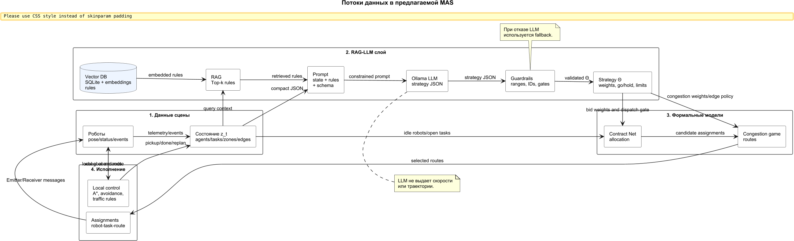
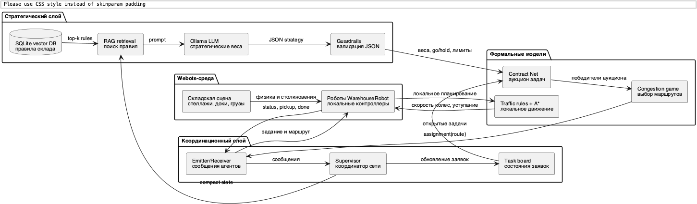
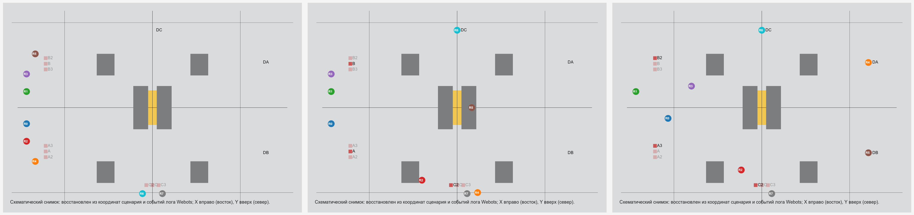

**Affiliation.** Ulyanovsk State Technical University, Ulyanovsk, Russia  
**Corresponding author.** K. V. Svyatov

**Abstract**  
This paper studies a simulation-based warehouse-like transport system in which a group of mobile robots executes delivery requests in an environment with shared corridors, alternative routes, and operating rules stated in natural language. The proposed approach uses a local large language model not as a motion planner or a low-level controller, but as a bounded strategic parameterizer of formal coordination models. Relevant rules are retrieved from a local vector knowledge base, interpreted by the language model, and validated by strict run-time constraints before they affect task allocation or routing. The validated strategy modifies only a limited set of weights, admissible robot sets, route penalties, and dispatch limits. Task allocation is performed by a contract-based protocol, route selection is modeled as a finite congestion game, and each robot executes its route using an individual controller. Experiments show that the language-model layer is useful when the operational rule is not directly encoded in the program or in the prompt, but must be retrieved and transformed into formal parameters. In a policy-masked series with 15--18 transport requests, retrieval-augmented parameterization reduced the mean completion time from 1882.9 ± 254.1 s to 1315.4 ± 159.2 s compared with the same language model without retrieval. The results support the conclusion that the contribution of a language model in such systems lies in safe interpretation of contextual rules, not in direct robot control.

**Keywords** Large language model; Robot group; Multi-agent transport system; Formal control model; Congestion game; Task allocation; Vector knowledge base; Safe artificial intelligence

# 1. Introduction

Warehouse transport systems are a representative class of multi-agent robotic systems. Their performance depends not only on the speed of individual robots, but also on coordination between task allocation, route choice, local collision avoidance, and operating constraints. A robot group may compete for requests, share narrow corridors, wait for loading zones, and adapt to temporary maintenance or inspection traffic. In such conditions, a single monolithic dispatcher is either too rigid for changing rules or too difficult to verify.

Formal coordination methods solve important parts of this problem. Contract-based allocation provides a reproducible mechanism for assigning requests to robots [1--3]. Traffic-aware routing and multi-agent path finding address shared resources and route conflicts [4, 5]. Congestion games describe situations in which the cost of a route grows with the number of agents using the same edges [6--8]. However, many operational rules in real facilities are not introduced as numerical coefficients. They are written or spoken as natural-language statements: an inspection cart is using the central crossing; the number of robots entering a loading area must be limited; urgent requests may use a shorter route; robots must continue with the last valid strategy if a strategic service is delayed.

The research problem is therefore not only to allocate tasks or compute paths, but to connect textual operating knowledge with formal coordination models. Direct use of a large language model as a robot controller is unsafe because it may generate unverified actions, non-existing objects, or inconsistent plans. The paper proposes a more restricted architecture: the language model is allowed to output only a bounded strategic vector. This vector is then checked by guard conditions and used by deterministic algorithms. The language model never sets wheel velocities, never creates new routes, and never modifies the local controller.

The object of study is a simulation-based warehouse-like multi-agent transport system. The subject of study is the mechanism that transforms natural-language operating rules into parameters of task allocation and route selection. The contribution of the paper is fourfold. First, a formal model is given that separates task allocation, congestion-game routing, and local execution. Second, a retrieval-augmented language-model pipeline is specified as a bounded parameterization layer rather than as a planner. Third, the architecture is implemented in Webots with individual robot controllers and a network coordinator. Fourth, the approach is evaluated against rule-based and non-retrieval baselines, including a policy-masked setting where the meaning of operating codes is available only through retrieval.

# 2. Related Work

Task allocation in robot groups is commonly studied within multi-robot task allocation. Early formal work defined taxonomies that relate robot capabilities, task structures, and optimization criteria [2]. The Contract Net Protocol remains one of the most natural models for transport tasks because it represents assignment as a distributed bidding process [1]. Market-based coordination methods extend this idea and provide scalable mechanisms for complex robot tasks [3]. In warehouse automation, allocation interacts strongly with route design, waiting policies, and traffic management; surveys of automated guided vehicles and autonomous mobile robots show that dispatching and routing policies influence throughput, waiting time, and deadlock risk [4, 5].

Route coordination is often represented as a graph problem. Search-based methods such as A* are used for shortest paths [9], while conflict-based search and related multi-agent path finding methods provide stronger guarantees for discrete route conflicts [10]. Congestion games offer a complementary abstraction: routes are strategies, graph edges are shared resources, and each robot's route cost depends on edge load [6]. The existence of a potential function for such games explains why best-response dynamics can converge to a pure Nash equilibrium under finite route sets [7]. These methods are mathematically clear, but they do not interpret textual changes in operating policy.

Retrieval-augmented generation connects language models with external documents [11]. Related prompting and agent methods show that language models can combine reasoning with tool use [12, 13]. In robotics, language models have been used for grounding high-level instructions, generating programs, or linking language to robot affordances [14--16]. Recent reviews emphasize both the opportunity and the risk: language models can adapt task-level behavior, but their output must be constrained and monitored before it affects physical systems [17, 18]. This motivates guarded architectures in which a model may propose only symbolic parameters or constraints.

The proposed approach is close to neuro-symbolic artificial intelligence and cognitive automation. Neuro-symbolic systems combine flexible neural interpretation with explicit symbolic structures [19]. Cognitive automation studies the transfer of human cognitive work into software while preserving case suitability and risk control [20]. In this paper, natural-language interpretation is neural, but execution remains symbolic and formally bounded. Guardrail methods for language models further support this design by validating schema, ranges, and identifiers before execution [21]. Webots is used as a simulation environment for validating the robot scene and controller interaction [22].

# 3. Problem Statement and Formal Model

The warehouse is represented as a directed graph \(G=(V,E)\). The set \(V\) contains intersections, loading zones, unloading zones, and service points. The set \(E\) contains admissible directed passages. The robot group is \(A=\{a_1,\ldots,a_m\}\), and the set of transport requests is \(T=\{\tau_1,\ldots,\tau_n\}\). For each request \(\tau\), the finite set \(R_\tau\) contains route candidates generated from the warehouse graph.

|  |  |
|---|---:|
| $$\Theta=(w_d,w_l,w_c,w_b,\mu,E_b,A^{go},A^{hold},N^{act},N^{new})$$ | (1) |

Equation (1) defines the strategic vector produced by the language-model layer after validation. The parameters \(w_d,w_l,w_c,w_b\) are non-negative weights for deadline urgency, travel length, congestion, and battery reserve. The parameter \(\mu\) is a safety margin used by local avoidance. The set \(E_b\subseteq E\) contains edges with an additional strategic penalty. The sets \(A^{go}\subseteq A\) and \(A^{hold}\subseteq A\) determine which robots may receive new assignments. The integers \(N^{act}\) and \(N^{new}\) limit the number of active tasks and the number of new assignments per dispatch cycle.

The binary variable \(y_{a\tau}\) is equal to 1 if robot \(a\) is assigned to request \(\tau\), and 0 otherwise. The assignment constraints are

|  |  |
|---|---:|
| $$\sum_{\tau\in T}y_{a\tau}\leq 1,\qquad \sum_{a\in A}y_{a\tau}\leq 1,\qquad y_{a\tau}\in\{0,1\}.$$ | (2) |

The first inequality in (2) means that one robot may execute at most one current request. The second inequality means that one request may be assigned to at most one robot. The binary condition states that partial assignment is not allowed.

To avoid artificial waves of requests, all requests may be available from the beginning. Loading and unloading conflicts are controlled by a family mapping \(\phi:T\rightarrow\{1,\ldots,g\}\), where each family corresponds to a shared pickup or drop-off resource:

|  |  |
|---|---:|
| $$\sum_{\tau:\phi(\tau)=j}\mathbb{I}\!\left(s_\tau\notin\{\mathrm{open},\mathrm{completed}\}\right)\leq 1,\qquad j=1,\ldots,g.$$ | (3) |

In (3), \(s_\tau\) is the state of request \(\tau\), and \(\mathbb{I}(\cdot)\) is the indicator function. The constraint permits all requests to exist, but allows only one active request per shared loading family. This models waiting for the release of a physical area rather than opening requests in manually defined waves.

The contract-based allocation layer computes a bid for each admissible robot-request pair:

|  |  |
|---|---:|
| $$b(a,\tau,t)=\rho_\tau+w_d\frac{\rho_\tau}{\max(\delta_\tau-t,\varepsilon)}-w_l\,d(x_a,p_\tau)-w_b(1-\beta_a).$$ | (4) |

In (4), \(\rho_\tau\) is the reward or priority of request \(\tau\), \(\delta_\tau\) is its deadline, \(t\) is current time, and \(\varepsilon>0\) prevents division by zero. The function \(d(x_a,p_\tau)\) estimates the distance from the current robot position \(x_a\) to the pickup point \(p_\tau\). The value \(\beta_a\in[0,1]\) is the normalized battery level. Thus, the bid increases for urgent and valuable requests, but decreases for distant robots and robots with low battery reserve. The greedy allocation cycle sorts bids and selects winners subject to (2), (3), \(A^{go}\), \(A^{hold}\), \(N^{act}\), and \(N^{new}\). Its dominant complexity is \(O(mn\log(mn))\) because all feasible bids are sorted.

For route selection, each assigned robot chooses one route from a finite route set. Let \({\mathbf r}=(r_1,\ldots,r_q)\) be the profile of selected routes, and let \(n_e({\mathbf r})\) be the number of selected routes that use edge \(e\). The route cost for robot \(i\) is

|  |  |
|---|---:|
| $$c_i(r_i,{\mathbf r}_{-i})=w_lL(r_i)+w_c\sum_{e\in r_i}n_e({\mathbf r})+M\sum_{e\in r_i}\mathbb{I}(e\in E_b).$$ | (5) |

In (5), \(L(r_i)\) is the geometric length of route \(r_i\), the second term penalizes edge sharing, and \(M\) is a large constant assigned to strategically undesirable edges. The vector \({\mathbf r}_{-i}\) denotes routes selected by all robots except robot \(i\).

The route game is a finite congestion game. Its potential function is

|  |  |
|---|---:|
| $$\Phi({\mathbf r})=\sum_i w_lL(r_i)+w_c\sum_{e\in E}\sum_{k=1}^{n_e({\mathbf r})}k+M\sum_i\sum_{e\in r_i}\mathbb{I}(e\in E_b).$$ | (6) |

The first term of (6) accumulates route lengths, the second term accumulates congestion cost over all shared edges, and the third term accumulates penalties for blocked or discouraged edges. A unilateral route change changes \(\Phi\) by the same amount as the individual cost in (5). Therefore, best-response dynamics over the finite route sets converges to a pure Nash equilibrium. In the implementation, the number of best-response rounds is limited because route sets are small and the decision must remain online.

The retrieval layer ranks rule documents by a hybrid score:

|  |  |
|---|---:|
| $$score(q,d)=0.68\cos(v_q,v_d)+0.32\,Dice(tokens(q),tokens(d)).$$ | (7) |

In (7), \(q\) is the state-dependent textual query, \(d\) is a document from the local rule base, \(v_q\) and \(v_d\) are normalized PyTorch vectors, and \(Dice(\cdot,\cdot)\) is the token-overlap coefficient. The cosine term captures vector similarity, while the token term stabilizes short operational codes.

The main performance metric is makespan:

|  |  |
|---|---:|
| $$M=\max_{\tau\in T} t_\tau^{done}-t_0.$$ | (8) |

In (8), \(t_\tau^{done}\) is the completion time of request \(\tau\), and \(t_0\) is the start time of the experiment. Additional metrics include total waiting time, total distance, number of bypass routes, success rate, and latency of the strategic layer.

# 4. Retrieval-Augmented Parameterization Pipeline

The language-model pipeline contains a local vector knowledge base, a prompt builder, a local language model, and a guard layer. The knowledge base is implemented as SQLite with PyTorch vectorization. It contains 19 short documents describing coordinate conventions, collision avoidance, congestion rules, dispatch gating, standard operating procedure codes, guard rules, and fallback behavior. The input to the knowledge base is not a free-form conversation. It is a compact textual query built from the current warehouse state: number of robots, number of requests, route variant, disrupted edges, deadline jitter, active policy codes, and a short description of the operational situation.

The retrieved documents are inserted into a constrained prompt. The model is instructed to return only a compact structured object with predefined fields: deadline weight, travel weight, congestion weight, battery weight, safety margin, traffic rule name, blocked edges, robots allowed to move, robots that must wait, and limits on active and new assignments. The output is then parsed and validated. Unknown robot identifiers, unknown edge identifiers, out-of-range weights, excessive assignment limits, and malformed values are removed or replaced by safe defaults.

This separation is essential. The language model may influence the values in \(\Theta\), but it cannot generate a path, command a motor, add a new graph edge, or bypass the local robot controller. If the model times out, returns invalid structured output, or produces semantically unsafe values, the system uses the last valid strategy or a deterministic fallback. Consequently, the physical behavior is always produced by formal algorithms acting on validated data.

{width=5.6in}

# 5. System Implementation

The system is implemented as a Webots project. A supervisor process acts as a network coordinator: it receives robot messages, maintains the state of requests, invokes the strategic layer, runs contract-based allocation and the congestion game, and sends assignments. It is not a manual driver. Each robot has its own Python controller, receives messages of the form `assignment(task, route)`, follows waypoint routes, performs local avoidance, and reports `pickup`, `done`, and `replan` events.

The main scene contains eight mobile robots and nine requests in three repeated pickup and drop-off families. All requests are initially visible, but equation (3) and the dispatch limits prevent all robots from moving into the same loading zones at once. Each request has a central route and one or more bypass routes. The key operating rule states that inspection or maintenance traffic occupies the central crossing; therefore, the strategy should either increase the cost of central routes or meter the release of robots.

{width=5.6in}

Table 1 summarizes how fields of \(\Theta\) enter the formal model.

*Table 1. Mapping between validated strategy fields and formal coordination procedures.*

| Strategy field | Formal use | Effect |
|---|---|---|
| \(w_d\) | Bid function (4) | Increases urgency of requests with close deadlines. |
| \(w_l\) | Bid function (4), route cost (5) | Penalizes travel to pickup and route length. |
| \(w_c\) | Route cost (5), potential (6) | Penalizes shared edges and congested corridors. |
| \(w_b\) | Bid function (4) | Reduces bids of robots with low battery reserve. |
| \(E_b\) | Route cost (5) | Discourages selected edges without deleting them from the graph. |
| \(A^{go},A^{hold}\) | Allocation filter | Meters robot release and prevents loading-zone crowding. |
| \(N^{act},N^{new}\) | Allocation constraints | Limits active work and new assignments per cycle. |
| \(\mu\) | Local avoidance | Changes the clearance margin used by robot controllers. |

# 6. Experimental Protocol

Experiments were performed in a headless simulator using the same Python modules for allocation, congestion-game routing, route tables, retrieval, and strategy validation as the Webots controllers. Webots was used to verify scene geometry, visual behavior, and controller communication. This protocol separates the algorithmic hypothesis from visual validation of the scene.

The main benchmark contains 30 randomized variants of the LM-9 scenario. The number of robots is varied in \(\{7,8,9\}\), and the route variant, disrupted edges, disruption delay, deadline factor, deadline jitter, reward jitter, and start jitter are randomized. All compared modes use the same seeds. The baselines are: contract-based allocation without congestion penalties; fixed congestion game; hand-tuned congestion penalty; prioritized planning; a rule parser without a generative model; the language model without retrieval; retrieval-augmented language-model parameterization; and a static domain rule that explicitly discourages the known central bottleneck.

A separate policy-masked series tests the specific role of retrieval. In this series, the prompt does not contain a direct explanation of the central crossing rule and does not include disrupted edge identifiers. It contains only the operational codes SOP-C7 and DOCK-AMBER. Their meanings are available only in the vector knowledge base. The number of requests is increased to 15--18, and the number of robots varies from 6 to 8; therefore, each robot performs several deliveries on average. This setting models a request stream rather than a single illustrative delivery.

Table 2 lists the main reproducibility parameters.

*Table 2. Reproducibility parameters of the experimental protocol.*

| Parameter | Value |
|---|---|
| Simulator | Webots R2023b for scene validation; headless Python simulator for statistical series. |
| Language model | Local Ollama model `qwen2.5:0.5b`; timeout 35 s. |
| Vector base | SQLite, 19 documents, 192 features, PyTorch hashed vectorization. |
| Repetitions | 30 seeds for LM-9 and policy-masked replay; 10 seeds for live policy-masked Ollama pilot. |
| Dispatch period | 5.0 s in the headless model; the language model is a strategic service. |
| Fallback | Deterministic bounded strategy with no direct motor control. |

# 7. Results

Table 3 presents the main LM-9 benchmark. Retrieval-augmented parameterization is substantially better than allocation without congestion penalties, fixed game routing, and the rule parser. The mean completion time decreases from 829.9 ± 75.4 s for contract-based allocation without congestion modeling to 645.5 ± 83.1 s. However, the language model without retrieval is almost identical in this scenario: 645.7 ± 83.3 s. This indicates that the direct textual description already contains enough information for the model, and retrieval mostly improves traceability. The static rule is still stronger because it hard-codes the correct response for the given geometry.

*Table 3. Main LM-9 benchmark, 30 seeds, mean ± standard deviation.*

| Mode | Makespan, s | Waiting, s | Distance | Strategic latency, s |
|---|---:|---:|---:|---:|
| Contract allocation only | 829.9 ± 75.4 | 913.5 ± 261.9 | 514.9 | 0.00 |
| Fixed congestion game | 829.9 ± 75.4 | 913.5 ± 261.9 | 514.9 | 0.00 |
| Hand-tuned penalty | 684.8 ± 145.3 | 253.0 ± 214.9 | 577.3 | 0.00 |
| Prioritized planning | 686.9 ± 94.4 | 0.0 ± 0.0 | 590.2 | 0.00 |
| Rule parser | 928.7 ± 76.7 | 598.2 ± 189.5 | 663.9 | 0.01 |
| Language model without retrieval | 645.7 ± 83.3 | 125.7 ± 193.4 | 688.9 | 7.83 |
| Retrieval-augmented language model | 645.5 ± 83.1 | 124.7 ± 194.4 | 685.4 | 9.21 |
| Static domain rule | 559.1 ± 103.8 | 123.3 ± 193.7 | 570.6 | 0.00 |

The paired sign test confirms that retrieval-augmented parameterization is significantly faster than contract allocation only, fixed game routing, prioritized planning, and the rule parser. It is not significantly better than the same language model without retrieval in the ordinary LM-9 case. It is significantly worse than the static rule, which acts as a manually encoded oracle for the central bottleneck. This negative result is important: a language model should not be used as an expensive replacement for a stable and already known deterministic rule.

The policy-masked series changes this conclusion. Because the prompt contains only SOP-C7 and DOCK-AMBER, the non-retrieval model does not know the meaning of these codes. The vector search retrieves the rule documents that describe the central crossing and loading-zone restrictions. As a result, retrieval-augmented replay reduces the makespan from 1882.9 ± 254.1 s to 1315.4 ± 159.2 s relative to the non-retrieval model. A deterministic embedding-rule baseline, which uses retrieval without generative interpretation, obtains 1517.3 ± 240.0 s. Thus, retrieval alone helps, but the language model improves the transformation of retrieved text into a balanced strategy.

*Table 4. Policy-masked experiment with SOP codes and 15--18 requests.*

| Mode | Seeds | Makespan, s | Bypass routes | Success rate |
|---|---:|---:|---:|---:|
| Keyword parser | 30 | 1932.3 ± 237.5 | 0.0 | 0.833 |
| Language model without retrieval, replay | 30 | 1882.9 ± 254.1 | 0.0 | 0.867 |
| Embedding-rule baseline | 30 | 1517.3 ± 240.0 | 11.1 | 0.967 |
| Retrieval-augmented replay | 30 | 1315.4 ± 159.2 | 12.9 | 1.000 |
| Static domain rule | 30 | 1255.8 ± 160.3 | 11.1 | 1.000 |
| Language model without retrieval, live | 10 | 1439.7 ± 398.7 | 8.4 | 0.900 |
| Retrieval-augmented live | 10 | 1331.2 ± 139.8 | 10.8 | 1.000 |

{width=5.5in}

# 8. Retrieval Quality, Safety, and Computational Cost

Retrieval quality was measured on 13 state queries covering maintenance, paraphrases, normal operation, dispatch rules, priority rules, guard behavior, latency, and masked SOP cases. At top-\(k=4\), precision was 0.423, recall was 0.591, and top-1 accuracy was 0.923. When each retrieved document was corrupted with probability 0.5, precision decreased to 0.231, recall to 0.358, and top-1 accuracy to 0.538. In the policy-masked scenario this degradation increased the makespan from 1315.4 ± 159.2 s to 1588.0 ± 365.2 s. The system did not collapse because guard rules and fallback policies still limited the output, but the result shows that retrieval quality is a causal factor when operating codes are hidden from the prompt.

The computational cost of live language-model calls is also significant. In the LM-9 benchmark, mean latency was 9.21 ± 2.42 s with retrieval and 7.83 ± 2.08 s without retrieval. This is too slow for a low-level robot controller. Therefore, the model must be called asynchronously and only on the strategic level. With a 30 s strategic period, the delay is a noticeable but acceptable overhead; with a 60 s period, it becomes a smaller part of the cycle. During the delay, robots continue using the last valid strategy, and local control is never blocked by a language-model request.

# 9. Discussion

The experiments do not support a broad claim that a large language model is always better than deterministic rules. The static domain rule is faster in the stable LM-9 geometry because it already encodes the correct response to the central bottleneck. If the warehouse layout and operating policy are fixed, such a rule is cheaper, faster, and easier to certify.

The positive result is more specific. A language model becomes useful when the operating rule changes, when it is written in natural language or encoded by an operational code, and when manual retuning of formal parameters is undesirable. In this case, retrieval supplies relevant knowledge, the language model converts it into a bounded strategy, and formal algorithms perform the actual allocation and routing. This is the intended division of responsibility. Neural interpretation handles contextual language; symbolic procedures preserve verifiability.

The industrial realism of the current simulation is limited. The scene is warehouse-like rather than a complete model of an industrial warehouse. Loading and unloading are simplified, charging and mechanical failures are not modeled, and the route graph abstracts away many details of robot dynamics. Nevertheless, the experiment is sufficient for testing the architectural hypothesis: a language-model layer can influence a robot group safely when its output is restricted to validated parameters of formal models.

# 10. Conclusion

The paper presented a bounded architecture for using a large language model in the control of a robot group. The model is not a direct controller. It is a strategic parameterization service whose output is retrieved, typed, range-checked, and then consumed by formal coordination models. Task allocation is performed by a contract-based protocol, route choice by a finite congestion game, and local execution by individual robot controllers.

The results identify the conditions under which the approach is useful. Retrieval-augmented language-model parameterization improves performance over generic and non-retrieval strategies when the operating rule is not explicitly present in the prompt and must be retrieved from a local knowledge base. It does not outperform a static rule that already encodes the correct answer for a stable bottleneck. Future work should extend the number of randomized scenes, add stronger multi-agent path finding and optimization baselines, replace simple hashed vectorization with trained local embeddings, and transfer the scenario to a more realistic mobile manipulator model with charging, failures, dynamic orders, and physical loading operations.

# References

1\. Smith RG (1980) The Contract Net Protocol: High-level communication and control in a distributed problem solver. IEEE Transactions on Computers C-29(12):1104--1113. doi:10.1109/TC.1980.1675516

2\. Gerkey BP, Matarić MJ (2004) A formal analysis and taxonomy of task allocation in multi-robot systems. The International Journal of Robotics Research 23(9):939--954. doi:10.1177/0278364904045564

3\. Dias MB, Zlot R, Kalra N, Stentz A (2006) Market-based multirobot coordination: a survey and analysis. Proceedings of the IEEE 94(7):1257--1270. doi:10.1109/JPROC.2006.876939

4\. Le-Anh T, De Koster MBM (2006) A review of design and control of automated guided vehicle systems. European Journal of Operational Research 171(1):1--23. doi:10.1016/j.ejor.2005.01.036

5\. Fragapane G, de Koster R, Sgarbossa F, Strandhagen JO (2021) Planning and control of autonomous mobile robots for intralogistics: literature review and research agenda. European Journal of Operational Research 294(2):405--426. doi:10.1016/j.ejor.2021.01.019

6\. Rosenthal RW (1973) A class of games possessing pure-strategy Nash equilibria. International Journal of Game Theory 2:65--67. doi:10.1007/BF01737559

7\. Monderer D, Shapley LS (1996) Potential games. Games and Economic Behavior 14(1):124--143. doi:10.1006/game.1996.0044

8\. Roughgarden T, Tardos É (2002) How bad is selfish routing? Journal of the ACM 49(2):236--259. doi:10.1145/506147.506153

9\. Hart PE, Nilsson NJ, Raphael B (1968) A formal basis for the heuristic determination of minimum cost paths. IEEE Transactions on Systems Science and Cybernetics 4(2):100--107. doi:10.1109/TSSC.1968.300136

10\. Sharon G, Stern R, Felner A, Sturtevant NR (2015) Conflict-based search for optimal multi-agent pathfinding. Artificial Intelligence 219:40--66. doi:10.1016/j.artint.2014.11.006

11\. Lewis P, Perez E, Piktus A et al (2020) Retrieval-augmented generation for knowledge-intensive NLP tasks. Advances in Neural Information Processing Systems 33:9459--9474

12\. Wei J, Wang X, Schuurmans D et al (2022) Chain-of-thought prompting elicits reasoning in large language models. Advances in Neural Information Processing Systems 35:24824--24837

13\. Yao S, Zhao J, Yu D et al (2023) ReAct: synergizing reasoning and acting in language models. International Conference on Learning Representations

14\. Ahn M, Brohan A, Brown N et al (2022) Do as I can, not as I say: grounding language in robotic affordances. arXiv:2204.01691. doi:10.48550/arXiv.2204.01691

15\. Liang J, Huang W, Xia F et al (2022) Code as policies: language model programs for embodied control. arXiv:2209.07753. doi:10.48550/arXiv.2209.07753

16\. Driess D, Xia F, Sajjadi MSM et al (2023) PaLM-E: an embodied multimodal language model. arXiv:2303.03378. doi:10.48550/arXiv.2303.03378

17\. Wang J, Wu Z, Li Y et al (2024) Large language models for robotics: opportunities, challenges, and perspectives. arXiv:2401.04334. doi:10.48550/arXiv.2401.04334

18\. Li P, An Z, Abrar S, Zhou L (2025) Large language models for multi-robot systems: a survey. arXiv:2502.03814. doi:10.48550/arXiv.2502.03814

19\. Sarker MK, Zhou L, Eberhart A, Hitzler P (2021) Neuro-symbolic artificial intelligence: current trends. AI Communications 34(3):197--209. doi:10.3233/AIC-210084

20\. Engel C, Elshan E, Ebel P, Leimeister JM (2024) Stairway to heaven or highway to hell: a model for assessing cognitive automation use cases. Journal of Information Technology 39(1):53--78. doi:10.1177/02683962231185599

21\. Dong Y, Mu R, Jin G et al (2024) Building guardrails for large language models. Proceedings of Machine Learning Research 235:11765--11787

22\. Michel O (2004) Cyberbotics Ltd. Webots: professional mobile robot simulation. International Journal of Advanced Robotic Systems 1(1):39--42. doi:10.5772/5618
